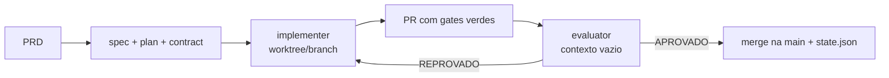

# AGENTS.md — porta de entrada dos agentes

<!-- TOC -->

- [AGENTS.md — porta de entrada dos agentes](#agentsmd--porta-de-entrada-dos-agentes)
  - [Comandos](#comandos)
  - [Endereços e credenciais (seed)](#endereços-e-credenciais-seed)
  - [Regras do projeto](#regras-do-projeto)
  - [Processo (SDD)](#processo-sdd)
  - [Mapa dos artefatos](#mapa-dos-artefatos)
  - [Estrutura do código](#estrutura-do-código)

<!-- TOC -->

Este arquivo é lido primeiro por qualquer agente (implementador, avaliador, corretor). Ferramentas que leem outro arquivo (ex.: `CLAUDE.md`) apontam para cá.

## Comandos

| Ação | Comando | Sem `make` |
| --- | --- | --- |
| Subir tudo (build, migração, seed, observabilidade) | `make up` | `./scripts/up.sh` |
| Derrubar tudo que a subida iniciou | `make down` | `./scripts/down.sh` |
| Gates (lint, typecheck, spec, relatórios, TOC, testes) | `make gates` | `./scripts/gates.sh` |
| Testes unitários (sobe e derruba o ambiente) | `make test-unit` | — |
| Testes de integração (sobe e derruba o ambiente) | `make test-integration` | — |
| Fluxo do avaliador via `curl` (ambiente no ar) | `make evaluator-flow` | `./scripts/evaluator-flow.sh` |
| Checar SO / dependências / portas | `make check-os`, `make check-dependencies`, `make check-ports` | `scripts/check-*.sh` |
| Instalar ferramentas locais (mise + node + deps) | `make install` | `./scripts/install.sh` |
| Regenerar / validar TOC | `make toc`, `make toc-check` | `node scripts/gen-toc.mjs [--check]` |
| Validar PRD × contratos | `make check-spec` | `node scripts/check-spec.mjs` |
| Validar relatórios e estado | `make check-reports` | `./scripts/check-reports.sh` |

Variáveis para rodar ambientes em paralelo (worktrees): `COMPOSE_PROJECT_NAME=catraca-f04 APP_PORT=8084 OBSERVABILITY=0 make up`. Lista completa em [docs/operations/configuracao.md](docs/operations/configuracao.md).

## Endereços e credenciais (seed)

- Produto e API: `http://localhost:${APP_PORT:-8080}` (`$WEB` = `$API`); Swagger em `/api/docs`.
- Organizador A: `organizador.a@catraca.local` / `catraca123`
- Organizador B: `organizador.b@catraca.local` / `catraca123`
- Participante: `participante@catraca.local` / `catraca123`
- Chave de parceiro (`X-Api-Key`): `catraca-partner-key-dev`

## Regras do projeto

1. **Fonte da verdade**: [TASK.md](TASK.md) → [docs/prd/PRD.md](docs/prd/PRD.md) → `docs/features/FXX-*/{spec,plan,contract}.md`. Comportamento novo precisa estar rastreado a uma regra R01–R13 e a um critério.
2. **Contrato fixo** da API de parceiros: campos, status HTTP e códigos de erro não mudam.
3. **Um único núcleo por regra**: compra/vagas só em `src/domain/purchase.ts` + `src/domain/seats.ts`; status do ingresso por gateway só no worker; cancelamento só em `src/domain/cancellation.ts`. Não duplique regras em rotas.
4. **Quem implementa não avalia.** Avaliação por subagente de contexto vazio (`.claude/agents/evaluator.md`); relatórios em `docs/features/FXX-*/reports/` são **imutáveis** (um commit cada).
5. **Estado**: `state/project-state.json` atualizado a cada mudança de status de feature.
6. **Idiomas**: documentação em pt-BR; código, identificadores e comentários em en-US.
7. **TOC** em todo `.md`, entre duas tags `<!-- TOC -->` (`make toc`).
8. **Erros** no padrão `[ERRO][CÓDIGO]` + causa provável + como resolver ([troubleshooting](docs/operations/troubleshooting.md)).
9. **Modo padrão** usa o gateway simulado; nunca adicione chaves reais.
10. Branches `feat/FXX-<nome>`; integração na `main` só por PR com gates verdes.

## Processo (SDD)



Waves: W1 F01 → W2 F02 ∥ F03 → W3 F04 ∥ F05 → W4 F06 ∥ F07 → W5 F08 ∥ F09 (detalhes no PRD).

## Mapa dos artefatos

| Artefato | Caminho |
| --- | --- |
| Brief / desafio | [TASK.md](TASK.md) |
| Plano de implementação | [PLAN.md](PLAN.md) |
| PRD | [docs/prd/PRD.md](docs/prd/PRD.md) |
| Features (spec, plano, contrato, relatórios) | [docs/features/](docs/features/) |
| Estado do projeto | [state/project-state.json](state/project-state.json) |
| Definições dos agentes | [.claude/agents/](.claude/agents/) |
| Arquitetura (diagramas + analogias) | [docs/architecture/](docs/architecture/) |
| Operação (portas, erros, observabilidade) | [docs/operations/](docs/operations/) |
| Requisitos por SO | [REQUIREMENTS.md](REQUIREMENTS.md) |
| Guia de contribuição | [CONTRIBUTING.md](CONTRIBUTING.md) |

## Estrutura do código

```text
src/
├── main.ts                 # HTTP entrypoint
├── config.ts               # environment configuration
├── app/                    # Fastify app, auth, routes, views (EJS), manage-page sections
├── domain/                 # business rules (events, seats, purchase, tickets, checkin, cancellation, dashboard)
├── gateway/                # PaymentGateway interface + simulated gateway
├── worker/                 # payment worker (applies gateway decisions)
├── db/                     # pool, migrations, seed
├── lib/                    # ids, money, time, errors
└── observability/          # logger, metrics, OpenTelemetry
tests/{unit,integration}/
```
