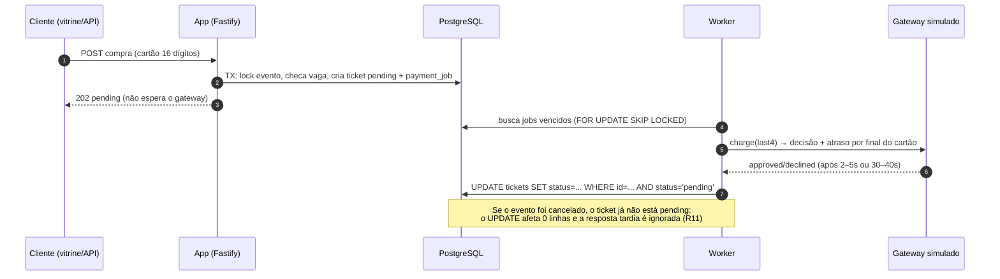
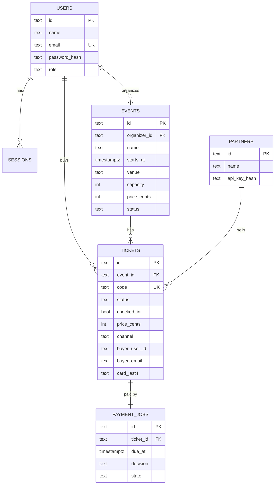
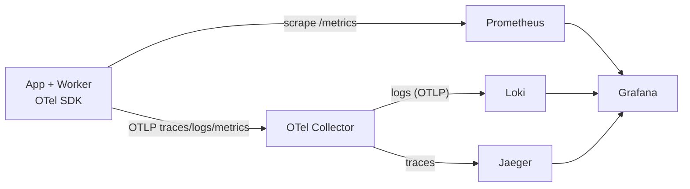
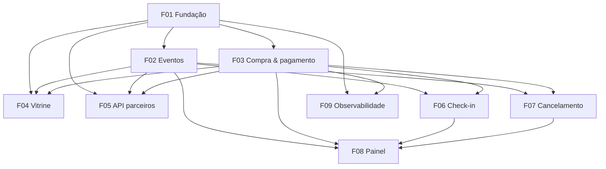
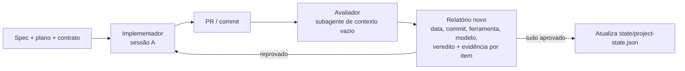

# Plano de implementação — Catraca

<!-- TOC -->

- [Plano de implementação — Catraca](#plano-de-implementação--catraca)
  - [1. Visão geral](#1-visão-geral)
  - [2. Decisões de arquitetura](#2-decisões-de-arquitetura)
    - [2.1 Stack](#21-stack)
    - [2.2 Garantia da lotação sob concorrência (R07)](#22-garantia-da-lotação-sob-concorrência-r07)
    - [2.3 Resposta assíncrona do gateway (R06, R08, R11)](#23-resposta-assíncrona-do-gateway-r06-r08-r11)
    - [2.4 Modelo de dados](#24-modelo-de-dados)
    - [2.5 Endereços e portas](#25-endereços-e-portas)
    - [2.6 Observabilidade](#26-observabilidade)
  - [3. Estrutura do repositório](#3-estrutura-do-repositório)
  - [4. Divisão em features, dependências e waves](#4-divisão-em-features-dependências-e-waves)
    - [4.1 Features](#41-features)
    - [4.2 Grafo de dependências](#42-grafo-de-dependências)
    - [4.3 Waves](#43-waves)
    - [4.4 Rastreabilidade das regras R01–R13](#44-rastreabilidade-das-regras-r01r13)
  - [5. Harness](#5-harness)
    - [5.1 Makefile](#51-makefile)
    - [5.2 Checagem de sistema operacional](#52-checagem-de-sistema-operacional)
    - [5.3 Mise e dependências](#53-mise-e-dependências)
    - [5.4 Imagens Docker multiplataforma](#54-imagens-docker-multiplataforma)
    - [5.5 Variáveis de ambiente e portas](#55-variáveis-de-ambiente-e-portas)
    - [5.6 Mensagens de erro e causa raiz](#56-mensagens-de-erro-e-causa-raiz)
    - [5.7 Seed](#57-seed)
  - [6. Testes](#6-testes)
  - [7. OpenAPI / Swagger](#7-openapi--swagger)
  - [8. Processo SDD com agentes](#8-processo-sdd-com-agentes)
    - [8.1 Artefatos por feature](#81-artefatos-por-feature)
    - [8.2 Ciclo implementar → avaliar → corrigir](#82-ciclo-implementar--avaliar--corrigir)
    - [8.3 Wave paralela com worktrees e tmux](#83-wave-paralela-com-worktrees-e-tmux)
    - [8.4 Arquivo de estado](#84-arquivo-de-estado)
  - [9. Documentação](#9-documentação)
    - [9.1 Arquivos obrigatórios](#91-arquivos-obrigatórios)
    - [9.2 TOC idempotente](#92-toc-idempotente)
    - [9.3 Diagramas Mermaid com analogias](#93-diagramas-mermaid-com-analogias)
    - [9.4 Conteúdo do CLAUDE.md](#94-conteúdo-do-claudemd)
  - [10. Roteiro de execução (fases)](#10-roteiro-de-execução-fases)
  - [11. Matriz: critérios de aceite do TASK.md → onde são atendidos](#11-matriz-critérios-de-aceite-do-taskmd--onde-são-atendidos)
  - [12. Riscos e mitigações](#12-riscos-e-mitigações)
  - [13. Checklist final de entrega](#13-checklist-final-de-entrega)
  - [14. Pontos em aberto](#14-pontos-em-aberto)
  - [15. Execução e desvios em relação a este plano](#15-execução-e-desvios-em-relação-a-este-plano)

<!-- TOC -->

## 1. Visão geral

Este plano transforma o brief do [TASK.md](TASK.md) no MVP da Catraca, construído por agentes, com:

- PRD com features, `Provides`/`Consumes`, grafo de dependências, waves e critérios cross-feature;
- spec, plano e contrato por feature, com avaliação independente e relatórios imutáveis;
- harness (Makefile, Docker Compose, seed, gates, `AGENTS.md`/`CLAUDE.md`);
- observabilidade (Prometheus, Grafana, Jaeger, Loki via OpenTelemetry);
- documentação em pt-BR com TOC, diagramas Mermaid e analogias;
- código e comentários em en-US.

Princípio que guia tudo: **as regras só valem se valerem quando as features se encontram**. Por isso a regra crítica de cada fluxo (lotação, status do ingresso, cancelamento) fica concentrada em **um único lugar do código** (o núcleo de compra/ingresso), e as demais features consomem esse núcleo em vez de reimplementá-lo.

## 2. Decisões de arquitetura

### 2.1 Stack

| Camada | Escolha | Motivo |
| --- | --- | --- |
| Runtime | Node.js LTS ativa (confirmar a versão em <https://nodejs.org/en/about/previous-releases> na implementação) + TypeScript | A máquina do avaliador já tem Node; uma linguagem só para web, API, worker, seed e testes |
| HTTP | Fastify 5 | Rápido, validação por JSON Schema (gera o OpenAPI de graça), plugins oficiais de cookie/sessão/swagger |
| Interface web | HTML renderizado no servidor (`@fastify/view` + EJS), formulários simples | Nenhum critério avalia design; zero build de frontend; fácil de testar por HTTP |
| Banco | PostgreSQL (última major estável) | Transações e `SELECT ... FOR UPDATE` para garantir R07; `FOR UPDATE SKIP LOCKED` para o worker |
| Acesso a dados | `pg` + SQL explícito; migrações SQL versionadas com runner próprio idempotente | Controle total das queries de concorrência; sem "mágica" de ORM |
| Senha | `bcryptjs` (JS puro: mesma imagem em amd64 e arm64, sem compilação nativa) | Hash seguro |
| Sessão | Cookie assinado `HttpOnly` + tabela `sessions` no Postgres | Sobrevive a restart; sem dependência extra |
| Testes | Vitest (unitários e integração) | TypeScript nativo, rápido |
| Lint/format | ESLint + Prettier, `tsc --noEmit`, `hadolint`, `shellcheck`, `markdownlint-cli2` | Gates objetivos |
| Observabilidade | OpenTelemetry SDK → OpenTelemetry Collector → Prometheus / Jaeger / Loki; Grafana | Correlação métricas ↔ traces ↔ logs |
| Containers | Docker Engine + Docker Compose v2 (Linux); Colima + Docker CLI + Compose (macOS) | Requisito do desafio; Colima substitui Docker Desktop no macOS |
| Ferramentas locais | mise (`.mise.toml`) | Versões fixas de node, jq, hadolint, shellcheck etc., sem instalar nada global |

### 2.2 Garantia da lotação sob concorrência (R07)

Estratégia: **bloqueio pessimista da linha do evento** dentro de uma transação.

```sql
BEGIN;
SELECT id, status, capacity, price_cents
  FROM events WHERE id = $1 FOR UPDATE;          -- serializa compras do mesmo evento
-- valida: existe, status = 'published' (senão 404 event_not_available)
SELECT count(*) FROM tickets
 WHERE event_id = $1 AND status IN ('pending','confirmed');
-- se count >= capacity → ROLLBACK → 409 sold_out / "Ingressos esgotados"
INSERT INTO tickets (..., status, price_cents) VALUES (..., 'pending', <preço vigente>);
INSERT INTO payment_jobs (...);                  -- mesma transação (outbox)
COMMIT;
```

- O **mesmo lock** é usado em: edição de lotação (R03), cancelamento (R11) e liberação de vaga por recusa (R08). Assim nenhuma dessas operações intercala com uma compra.
- Defesa em profundidade: um *trigger* `BEFORE INSERT/UPDATE` em `tickets` que rejeita a operação se as vagas ocupadas passarem da lotação (garante a invariante mesmo se alguém esquecer o lock no código).
- Prova: teste de integração que roda a rajada do passo 15 (30 compras simultâneas, lotação 5) **em N eventos novos (N ≥ 20)** e um teste de estresse no banco com 200 compras concorrentes; ambos fazem parte dos gates.
- Alternativa documentada no README (Decisões): `UPDATE events SET occupied = occupied + 1 WHERE id=$1 AND occupied < capacity` (contador atômico). Descartada para não manter um contador redundante que precisaria ser sincronizado em recusa/cancelamento.

### 2.3 Resposta assíncrona do gateway (R06, R08, R11)



- O **gateway simulado** é um módulo atrás da interface `PaymentGateway` (`charge(request) → Promise<Decision>`), com a tabela de finais do cartão do brief. O atraso é sorteado no intervalo correto; o fator `GATEWAY_DELAY_SCALE` (padrão `1`) só é alterado nos testes.
- O **worker** é um processo separado (mesma imagem, outro comando) no Compose. Jobs persistidos em `payment_jobs` sobrevivem a restart.
- O número do cartão **nunca é persistido**: só os 4 últimos dígitos.
- **Cancelamento (R11)**: em uma transação, com o lock do evento: `status='cancelled'`, `confirmed → refunded`, `pending → cancelled`, jobs pendentes marcados como `obsolete`. Acontece na hora (bem abaixo dos 10 s).

### 2.4 Modelo de dados



- IDs: strings com prefixo (`evt_`, `tkt_`, `usr_`) + sufixo aleatório.
- Código do ingresso: 8 caracteres `[A-Z0-9]` sem ambíguos, único (`UNIQUE` + retry).
- `events.status`: `draft | published | cancelled`. `tickets.status`: `pending | confirmed | declined | cancelled | refunded`; `checked_in` é campo à parte.
- `tickets.price_cents` congela o preço vigente na compra (R03, R12).

### 2.5 Endereços e portas

Um único serviço HTTP atende interface e API: `$WEB = $API = http://localhost:${APP_PORT}` (padrão `8080`). Rotas:

| Rota | Quem |
| --- | --- |
| `/` vitrine, `/events/:id` | Visitante/participante |
| `/signup`, `/login`, `/logout`, `/me/tickets` | Participante |
| `/organizer/events`, `/organizer/events/:id` (página de gestão: editar, publicar, cancelar, check-in, painel) | Organizador (R04, R13) |
| `/api/partner/*` | Parceiro (contrato fixo) |
| `/api/docs` (Swagger UI), `/api/openapi.json` | Testes/documentação |
| `/healthz`, `/readyz`, `/metrics` | Harness/observabilidade |

R13: o acesso a `/organizer/events/:id` de outro organizador responde **404 com página genérica** (sem nome, números ou ingressos); participante/visitante recebem redirect para login ou 403 sem dados.

### 2.6 Observabilidade



- **Prometheus**: métricas de negócio e técnicas — `catraca_tickets_created_total{channel}`, `catraca_tickets_by_status{event,status}`, `catraca_purchases_rejected_total{reason}` (`sold_out`, `event_not_available`, `invalid_request`), `catraca_pending_confirmations` (gauge), `catraca_gateway_calls_total{outcome}` e `catraca_gateway_latency_seconds` (histograma — chamadas ao "provedor externo"), `catraca_checkins_total{result}`, `catraca_revenue_cents{event}`, `catraca_refunds_total`, latência HTTP por rota (`http_server_request_duration_seconds`), duração das avaliações de agentes quando registradas.
- **Grafana** (provisionado por arquivo): datasources Prometheus, Loki e Jaeger; *derived fields* no Loki (`trace_id` → Jaeger) e *traces to logs* no Jaeger (→ Loki); dashboards "Catraca — Negócio" (vendas, esgotados, pendentes, receita, check-ins, estornos) e "Catraca — Técnico" (RPS, p50/p95, erros, gateway, fila do worker).
- **Jaeger** (all-in-one, OTLP habilitado): spans de HTTP, SQL (`pg`), job do worker e chamada ao gateway.
- **Loki**: logs JSON (pino) com `trace_id`/`span_id`, enviados por OTLP via Collector (Promtail não será usado: está descontinuado).
- Todos os serviços de observabilidade ficam no mesmo `docker-compose.yml`; `make up` sobe tudo por padrão e `OBSERVABILITY=0 make up` sobe só o produto. `make down` derruba **todos os perfis**.

## 3. Estrutura do repositório

```text
.
├── AGENTS.md                 # porta de entrada dos agentes
├── CLAUDE.md                 # aponta p/ AGENTS.md + guardrails de manutenção
├── CONTRIBUTING.md
├── README.md                 # pt-BR; aponta para docs/
├── REQUIREMENTS.md           # genérico → redireciona por SO
├── Makefile
├── .mise.toml
├── .env.example              # todas as variáveis com padrão e comentário
├── docker-compose.yml
├── docker/
│   ├── app.Dockerfile        # multi-stage, multi-arch
│   ├── otel-collector.yaml
│   ├── prometheus.yml
│   ├── loki.yaml
│   └── grafana/{provisioning,dashboards}/
├── scripts/
│   ├── check-os.sh           # valida SO/arquitetura suportados
│   ├── check-deps.sh         # valida docker, compose, colima, mise...
│   ├── check-ports.sh        # porta em uso → erro com causa + variável a ajustar
│   ├── install.sh            # instala mise (usuário) + `mise install` + npm ci
│   ├── up.sh / down.sh / gates.sh / run-tests.sh / install.sh  # mesmos alvos do Makefile, sem make
│   ├── gen-toc.mjs           # TOC idempotente entre <!-- TOC --> ... <!-- TOC -->
│   ├── check-reports.sh      # relatórios imutáveis + state.json consistente
│   └── evaluator-flow.sh     # passos de curl do Fluxo do avaliador
├── src/
│   ├── app/ (server, plugins, routes/web, routes/partner, views)
│   ├── domain/ (events, purchase, payment, checkin, cancellation, dashboard)
│   ├── db/ (pool, migrations/*.sql, migrate.ts, seed.ts)
│   ├── worker/ (payment-worker.ts)
│   ├── gateway/ (payment-gateway.ts, simulated-gateway.ts)
│   └── observability/ (otel.ts, metrics.ts, logger.ts)
├── tests/
│   ├── unit/
│   └── integration/          # cobre os passos 2–16 do Fluxo do avaliador
├── docs/
│   ├── README.md             # índice da documentação
│   ├── prd/PRD.md
│   ├── features/F0X-<nome>/{spec.md,plan.md,contract.md,reports/}
│   ├── architecture/         # diagramas Mermaid + analogias
│   ├── requirements/{ubuntu.md,macos.md}
│   └── operations/           # portas, variáveis, troubleshooting, observabilidade
├── state/project-state.json
└── .claude/agents/{implementer.md,evaluator.md}
```

## 4. Divisão em features, dependências e waves

### 4.1 Features

| ID | Feature | Provides | Consumes | Regras |
| --- | --- | --- | --- | --- |
| F01 | Fundação: harness, schema, contas, autenticação, seed | Schema completo (users, events, tickets, payment_jobs, partners, sessions), migrações, `requireRole`, sessão, cadastro/login/logout de participante, seed (2 organizadores, 1 participante, 1 parceiro), Makefile/Compose, auth `X-Api-Key` | — | R13 (papéis) |
| F02 | Gestão de eventos do organizador | Criar/editar/publicar evento, página de gestão com URL própria, isolamento por organizador, `eventsRepo.findPublished()` | F01 | R01, R02, R03 (validação de lotação via núcleo F03), R04, R13 |
| F03 | Núcleo de compra e pagamento | `purchaseTicket(eventId, buyer, card)` com lock (R05–R07), código único (R09), preço congelado, gateway simulado + worker (R08), `seatsAvailable(eventId)` | F01 | R03, R05, R06, R07, R08, R09 |
| F04 | Vitrine e área do participante | Vitrine de publicados, página do evento, compra, "Ingressos esgotados", "Meus ingressos" | F01, F02, F03 | R02, R05–R09 |
| F05 | API de parceiros + OpenAPI | 3 rotas do contrato fixo, erros na ordem, Swagger em `/api/docs` | F01, F02, F03 | R02, R05–R09 |
| F06 | Check-in | Formulário na página de gestão, mensagens exatas de R10 na ordem | F02, F03 | R10, R13 |
| F07 | Cancelamento de evento | Cancelar irreversível, transição de tickets, bloqueio de edição/republicação, resposta tardia ignorada | F02, F03 | R11, R02 |
| F08 | Painel do evento | 6 números de R12 a partir dos tickets (vitrine + API) | F02, F03, F06, F07 | R12, R05, R03 |
| F09 | Observabilidade | Collector, Prometheus, Grafana (dashboards), Jaeger, Loki, métricas de negócio | F01, F03 | — (suporte) |

> **Por que o schema inteiro fica na F01:** permite que F02 e F03 rodem em paralelo sem conflitos de migração; cada feature posterior só adiciona índices/colunas com migração nova numerada.

### 4.2 Grafo de dependências



Cada aresta terá **pelo menos um critério cross-feature** no PRD (ex.: `XF-F03→F07-01`: "ticket pendente de compra via API vira `cancelled` ao cancelar o evento e continua assim após a resposta do gateway"; `XF-F05→F08-01`: "compra pela API aparece em Confirmados e na Receita do painel"; `XF-F02→F05-01`: "rascunho não aparece em `GET /api/partner/events`").

### 4.3 Waves

| Wave | Features | Execução |
| --- | --- | --- |
| W1 | F01 | sequencial |
| W2 | F02 ∥ F03 | **paralela** (worktrees + PRs) |
| W3 | F04 ∥ F05 | **paralela** (worktrees + PRs) — é a wave que será listada no README como prova |
| W4 | F06 ∥ F07 | paralela |
| W5 | F08 ∥ F09 | paralela |

### 4.4 Rastreabilidade das regras R01–R13

O PRD terá uma tabela `Regra → critérios` garantindo que **cada R01–R13 aparece em ≥ 1 critério**, e `scripts/check-spec.mjs` (parte dos gates) valida automaticamente:

- cada regra R01–R13 citada em algum critério do PRD;
- cada aresta do grafo tem ≥ 1 critério `XF-*`;
- cada critério de feature e cada `XF-*` aparece no mapeamento de ≥ 1 `contract.md`;
- cada feature tem `spec.md`, `plan.md`, `contract.md` e ≥ 1 relatório.

## 5. Harness

### 5.1 Makefile

| Alvo | O que faz |
| --- | --- |
| `make help` | Lista alvos (padrão) |
| `make check-os` | Valida SO/arquitetura suportados (5.2) |
| `make check-dependencies` | Valida Docker, Compose v2, daemon ativo, Colima (macOS), mise, Node; mostra URL oficial de instalação do que faltar |
| `make install` | Instala **somente** mise (no diretório do usuário) e as ferramentas de `.mise.toml` + `npm ci`. Não instala Docker |
| `make build` | `docker compose build` (com `PLATFORM` opcional) |
| `make build-multiarch` | `docker buildx build --platform linux/amd64,linux/arm64` |
| `make up` | check-os → check-dependencies (só Docker) → check-ports → build → `up -d` → migra → seed → espera healthchecks → imprime URLs e credenciais |
| `make down` | `docker compose --profile "*" down --remove-orphans` e confirma que nenhuma porta responde |
| `make restart` | down + up |
| `make logs [SERVICE=app]` | Logs |
| `make seed` | Reexecuta a seed (idempotente) |
| `make lint` / `make typecheck` | Gates estáticos |
| `make test-unit` | `make up` → testes unitários → `make down` → resumo |
| `make test-integration` | `make up` → testes de integração → `make down` → resumo (sempre derruba, mesmo com falha, e devolve o código de saída do teste) |
| `make test` | unit + integration |
| `make gates` | lint + typecheck + check-spec + check-reports + toc-check + test |
| `make toc` / `make toc-check` | Gera/valida TOC |
| `make evaluator-flow` | Roda `scripts/evaluator-flow.sh` contra o ambiente em pé |
| `make clean` | down + remove volumes do projeto (pede confirmação) |

**Um comando a partir de um clone limpo:** `make up` precisa só de Docker + make. Como fallback para máquinas sem `make`, `./scripts/up.sh`, `./scripts/down.sh` e `./scripts/gates.sh` fazem o mesmo (o Makefile chama esses scripts, então não há duplicação de lógica). A migração e a seed rodam em um serviço `migrate` do Compose (`depends_on: condition: service_completed_successfully`), então `docker compose up` sozinho também funciona.

### 5.2 Checagem de sistema operacional

`scripts/check-os.sh` (chamado por `make check-os` e no início de `make up`/`make install`):

| SO | Versões | Arquiteturas |
| --- | --- | --- |
| Ubuntu | 22.04, 24.04, 26.04 (lê `/etc/os-release`) | amd64 (`x86_64`) |
| macOS | versões com suporte do Colima (lê `sw_vers`) | amd64 e arm64 |

Fora dessa matriz: mensagem clara (`[ERRO][OS-001] SO não suportado: <detectado>. Suportados: ...`) e saída ≠ 0. `ALLOW_UNSUPPORTED_OS=1` permite tentar mesmo assim (com aviso), útil para WSL e outras distros.

### 5.3 Mise e dependências

- `.mise.toml` fixa: `node` (LTS), `jq`, `shellcheck`, `hadolint`, `markdownlint-cli2` (via npm). `tmux`, `git` e Docker vêm do sistema operacional.
- `make install`: instala mise via método oficial (<https://mise.jdx.dev/getting-started.html>) em `~/.local/bin`, roda `mise trust && mise install` e `npm ci`. Nada com `sudo`, nada global.
- **Docker e Compose não são instalados pelo projeto**; `make check-dependencies` mostra as URLs oficiais:
  - Ubuntu: <https://docs.docker.com/engine/install/ubuntu/> e <https://docs.docker.com/compose/install/linux/>
  - macOS: Colima <https://github.com/abiosoft/colima> (+ Docker CLI e plugin Compose via Homebrew: `brew install colima docker docker-compose`), com instrução de `colima start --cpu 4 --memory 6` e de configurar `cliPluginsExtraDirs` do Compose.
- Docker Desktop **não** é usado no macOS.

### 5.4 Imagens Docker multiplataforma

- `docker/app.Dockerfile` multi-stage (`deps` → `build` → `runtime`), base oficial `node:<LTS>-bookworm-slim` (multi-arch), usuário não-root, `HEALTHCHECK`, `tini` como init.
- Todas as imagens de terceiros (postgres, otel-collector, prometheus, grafana, jaeger, loki) com tag fixa e manifest multi-arch (amd64 + arm64) — verificado com `docker buildx imagetools inspect` durante a fase 1 e registrado em `docs/operations/imagens.md`.
- `make build-multiarch` constrói `linux/amd64,linux/arm64`. No macOS arm64 com Colima a imagem nativa é `linux/arm64`; em Ubuntu amd64, `linux/amd64`.
- Sem dependências nativas: `bcryptjs` é JS puro, então a imagem constrói igual nas duas arquiteturas.

### 5.5 Variáveis de ambiente e portas

Todas documentadas em `.env.example` e `docs/operations/configuracao.md`. O Compose usa `${VAR:-padrão}`, então **nenhum `.env` é necessário** para subir.

| Variável | Padrão | Uso |
| --- | --- | --- |
| `APP_PORT` | `8080` | `$WEB` e `$API` |
| `POSTGRES_PORT` | `5432` (só exposto se `EXPOSE_DB=1`) | Debug |
| `GRAFANA_PORT` | `3000` | Grafana |
| `PROMETHEUS_PORT` | `9090` | Prometheus |
| `JAEGER_UI_PORT` | `16686` | Jaeger |
| `LOKI_PORT` | `3100` | Loki |
| `OTEL_COLLECTOR_PORT` | `4318` | OTLP HTTP (interno, opcional expor) |
| `OBSERVABILITY` | `1` | `0` sobe só o produto |
| `GATEWAY_MODE` | `simulated` | Único modo implementado |
| `GATEWAY_DELAY_SCALE` | `1` | Só testes usam valor menor |
| `PARTNER_API_KEY` | valor documentado no README | Seed do parceiro |
| `LOG_LEVEL` | `info` | pino |
| `COMPOSE_PROJECT_NAME` | `catraca` | Isola containers/volumes |

### 5.6 Mensagens de erro e causa raiz

Padrão de mensagem em todo o projeto (Makefile, scripts, app, worker, agentes):

```text
[ERRO][<CÓDIGO>] <o que falhou>
  Causa provável: <diagnóstico>
  Como resolver:  <ação concreta, ex.: "export APP_PORT=8081 && make up">
  Detalhes:       <comando/log para investigar>
```

- `check-ports.sh`: detecta porta em uso (`ss`/`lsof`), mostra o processo e a variável a trocar.
- `up.sh`: `docker compose up -d --wait` com timeout (`UP_TIMEOUT`); em falha imprime `docker compose ps -a` e as últimas linhas de log de `migrate`, `app`, `worker` e `postgres`.
- App: erros com `code` estável (`DB_UNAVAILABLE`, `MIGRATION_FAILED`, `GATEWAY_TIMEOUT`...), `trace_id` em todo log, fail-fast na inicialização com a variável/porta culpada.
- Catálogo de códigos em `docs/operations/troubleshooting.md`.
- Agentes: `AGENTS.md` instrui a registrar no relatório o comando, a saída e o código de erro em vez de "deu erro".

### 5.7 Seed

- Idempotente (`INSERT ... ON CONFLICT DO NOTHING`/upsert por e-mail), roda em toda subida.
- Cria: Organizador A, Organizador B, Participante, Parceiro (chave). Credenciais fixas documentadas no README e em `AGENTS.md`.
- Não cria eventos (o fluxo do avaliador cria os seus); opcional `SEED_DEMO=1` cria eventos de demonstração.

## 6. Testes

| Tipo | Ferramenta | Cobertura |
| --- | --- | --- |
| Unitários | Vitest | Validações R01/R03, regras do gateway simulado (final → decisão/atraso), ordem das mensagens de check-in R10, ordem dos erros da API, cálculo do painel R12, geração de código/IDs, máquina de estados do ticket |
| Integração | Vitest + `fetch` com cookie jar contra o stack em pé | Passos 2–16 do Fluxo do avaliador (web via formulários HTTP, API via contrato), com `GATEWAY_DELAY_SCALE` reduzido para velocidade + uma suíte `@slow` em escala 1 para os cartões `0003/0004` |
| Concorrência | Vitest + `Promise.all` | 30 compras × lotação 5 em ≥ 20 eventos novos: sempre 5×202 e 25×409; 200 compras concorrentes direto no serviço |
| Contrato | Validação das respostas contra `openapi.json` | Campos e status das 3 rotas |
| Fluxo do avaliador | `scripts/evaluator-flow.sh` (curl) | Reproduz literalmente os comandos do TASK.md em escala real |

`make test-unit` e `make test-integration` rodam `make up` antes e `make down` depois (com `trap`), exibindo um resumo com contadores e caminho de relatório JUnit em `reports/tests/`.

## 7. OpenAPI / Swagger

- `@fastify/swagger` gera o OpenAPI 3 a partir dos JSON Schemas das rotas; `@fastify/swagger-ui` em `GET /api/docs`; JSON em `GET /api/openapi.json`.
- Esquema de segurança `apiKey` no header `X-Api-Key` (botão "Authorize" do Swagger com a chave da seed).
- Exemplos do contrato fixo (`evt_8f2k`, `tkt_51xq`) e todas as respostas de erro (`401`, `404`, `409`, `422`).
- Teste de contrato garante que a doc não diverge da implementação.

## 8. Processo SDD com agentes

### 8.1 Artefatos por feature

`docs/features/F0X-<nome>/`:

- `spec.md` — decisões técnicas, interfaces providas/consumidas, regras cobertas.
- `plan.md` — etapas pequenas e commitáveis.
- `contract.md` — pré-requisitos de ambiente; itens `C-F0X-NN` verificáveis por comando/efeito observável; tabela `Critério PRD → itens do contrato` (incluindo os `XF-*` que a feature cobre).
- `reports/AAAA-MM-DDTHHMM-<commit>.md` — um arquivo **novo** por avaliação, nunca editado.

### 8.2 Ciclo implementar → avaliar → corrigir



- `.claude/agents/evaluator.md`: subagente com instruções para ler **só** o `contract.md`, `AGENTS.md` e o README, subir o ambiente, exercitar cada item e gravar evidências (saída de comando, resposta HTTP, HTML relevante). Ele não recebe o histórico do implementador.
- `.claude/agents/implementer.md`: implementa a partir de spec/plano; proibido escrever em `reports/`.
- `scripts/check-reports.sh` (gate): cada relatório aparece em **um único commit** (`git log --format=%h -- <arquivo> | wc -l == 1`), tem os campos obrigatórios, e o mais recente de cada feature tem 100% `APROVADO`.

### 8.3 Wave paralela com worktrees e tmux

```bash
git worktree add ../catraca-F04 -b feat/F04-vitrine
git worktree add ../catraca-F05 -b feat/F05-api-parceiros
tmux new-session -d -s w3 -c ../catraca-F04 'claude'
tmux split-window -h -t w3 -c ../catraca-F05 'claude'
```

- Cada agente faz o **primeiro commit cedo** (ex.: esqueleto das rotas) e só termina depois que o outro já começou → requisito "o primeiro commit de cada PR é anterior ao último commit dos outros".
- Cada worktree usa `COMPOSE_PROJECT_NAME` e `APP_PORT` próprios para subir ambientes isolados em paralelo.
- PRs abertos com `gh pr create`; conflitos resolvidos na integração (rebase sobre `main`); links dos PRs no README.
- Repetir em W2, W4 e W5 (não obrigatório, mas aumenta a evidência).

### 8.4 Arquivo de estado

`state/project-state.json`:

```json
{
  "updatedAt": "2026-11-25T00:00:00-03:00",
  "features": {
    "F01": { "name": "Fundação", "wave": 1, "status": "done",
             "branch": "feat/F01-fundacao", "pr": "https://github.com/.../pull/1",
             "latestReport": "docs/features/F01-fundacao/reports/2026-11-26T1010-abc1234.md" }
  }
}
```

Status possíveis: `todo | in_progress | in_review | changes_requested | done`. O gate valida que todo caminho existe e que, na entrega, tudo é `done`.

## 9. Documentação

### 9.1 Arquivos obrigatórios

| Arquivo | Conteúdo |
| --- | --- |
| `README.md` (pt-BR, substitui o atual) | Como rodar, Endereços, Credenciais, Mapa dos artefatos (+ links dos PRs paralelos), Decisões (stack, R07, gateway assíncrono, isolamento da avaliação), link para `docs/` |
| `AGENTS.md` | Comandos (up/down/gates), regras do projeto, convenções (en-US no código, pt-BR na doc), mapa dos artefatos, processo SDD, padrão de erro |
| `CLAUDE.md` | Aponta para `AGENTS.md` + guardrails (9.4) |
| `CONTRIBUTING.md` | Fluxo de branch/PR, worktrees, como rodar gates, padrão de commits, como pedir avaliação, como atualizar TOC/diagramas |
| `REQUIREMENTS.md` | Genérico: detecta seu SO com `make check-os` e redireciona para `docs/requirements/ubuntu.md` ou `docs/requirements/macos.md` |
| `docs/requirements/ubuntu.md` | `make check-os`, `make check-dependencies`, `make install` + instalação manual oficial (Docker Engine apt repo, Compose plugin, pós-instalação sem sudo, mise) para 22.04/24.04/26.04 |
| `docs/requirements/macos.md` | Mesmo para macOS amd64/arm64 com Homebrew + Colima + Docker CLI + Compose plugin |
| `docs/architecture/*.md` | Diagramas e analogias (9.3) |
| `docs/operations/*.md` | Configuração/portas, troubleshooting (códigos de erro), observabilidade (como usar Grafana/Jaeger/Loki), imagens |

### 9.2 TOC idempotente

`scripts/gen-toc.mjs` (Node puro, sem dependências):

- Insere/atualiza o sumário **entre duas tags idênticas `<!-- TOC -->`** (abre e fecha com a mesma tag, formato compatível com plugins de Markdown como o *Markdown All in One*; não usar `<!-- /TOC -->`).
- Se o bloco existe, **substitui** o conteúdo; se não existe, insere logo após o título H1. Nunca duplica.
- Ignora headings dentro de blocos de código; gera âncoras no padrão do GitHub (acentos preservados, pontuação removida, duplicadas com sufixo `-1`).
- `make toc` aplica em todos os `.md` (exceto `node_modules`, `reports/` — relatórios são imutáveis e são gerados já com TOC); `make toc-check` falha se algum arquivo mudaria (faz parte dos gates). Rodar duas vezes seguidas não gera diff.

### 9.3 Diagramas Mermaid com analogias

Em `docs/architecture/`, cada diagrama vem acompanhado de uma analogia para iniciantes:

| Documento | Diagrama | Analogia |
| --- | --- | --- |
| `visao-geral.md` | C4/flowchart dos containers | "Uma casa de shows": bilheteria (app), cofre (Postgres), maquininha de cartão (gateway), caixa que confere comprovantes (worker), câmeras e livro de ocorrências (observabilidade) |
| `fluxo-compra.md` | sequência compra → gateway → worker | Pedido no restaurante: a comanda (ticket pendente) é entregue na hora; a cozinha (gateway) responde depois |
| `concorrencia.md` | sequência de duas compras disputando a última vaga | Catraca física: só uma pessoa passa por vez pelo cadeado (lock) |
| `estados-ingresso.md` | `stateDiagram` dos 5 status + `checkedIn` | Semáforo/etiqueta do ingresso |
| `api-parceiros.md` | sequência das 3 rotas e ordem de erros | Porteiro que confere crachá (chave) antes de tudo |
| `checkin.md` | flowchart da lista ordenada de R10 | Segurança na porta conferindo a lista na ordem |
| `cancelamento.md` | sequência do cancelamento + resposta tardia | Show cancelado: devolve dinheiro de quem pagou e rasga as comandas pendentes; o "aprovado" que chegar depois vai para o lixo |
| `classes.md` | `classDiagram` dos módulos de domínio/repositórios/gateway | Departamentos de uma empresa |
| `testes.md` | pirâmide de testes e fluxo `make test-*` | Ensaio geral antes do show |
| `agentes.md` | fluxo implementador/avaliador, waves, worktrees | Cozinheiro e crítico gastronômico: quem cozinha não dá a nota |
| `observabilidade.md` | fluxo OTel → backends → Grafana | Painel do carro: velocímetro (métricas), GPS da viagem (traces), diário de bordo (logs) |

### 9.4 Conteúdo do CLAUDE.md

Primeira linha: "Leia e siga o [AGENTS.md](AGENTS.md)". Depois, guardrails:

1. **Fonte da verdade:** `TASK.md` → PRD → spec/contrato. Qualquer mudança de comportamento precisa estar rastreada a uma regra R01–R13 e refletida em PRD, contrato e testes; nunca alterar o contrato fixo da API de parceiros.
2. **Idiomas:** documentação em pt-BR; código, identificadores e comentários em en-US.
3. **TOC:** todo `.md` tem TOC no início entre duas tags `<!-- TOC -->`; rodar `make toc` após editar Markdown; `make toc-check` nos gates.
4. **Diagramas e analogias:** ao mudar arquitetura, fluxo da API, testes, classes ou processo de agentes, atualizar o diagrama Mermaid e a analogia correspondentes em `docs/architecture/`.
5. **Relatórios imutáveis:** nunca editar arquivos em `docs/features/*/reports/`; reavaliação gera arquivo novo; implementador não avalia.
6. **Estado:** atualizar `state/project-state.json` ao mudar status de feature.
7. **Erros:** seguir o padrão `[ERRO][CÓDIGO]` com causa provável e como resolver; documentar códigos novos em `troubleshooting.md`.
8. **Portas/variáveis:** toda variável nova vai para `.env.example`, `docs/operations/configuracao.md` e README.
9. **Atualização de dependências — somente quando explicitamente solicitado:**
   - consultar fontes oficiais (nodejs.org, releases do PostgreSQL, Docker docs, mise, Colima, Grafana/Prometheus/Jaeger/Loki/OTel Collector, npm);
   - atualizar `.mise.toml`, `package.json`/lockfile, tags de imagem no Compose/Dockerfile;
   - verificar manifest multi-arch (`docker buildx imagetools inspect`) para amd64 e arm64;
   - revisar a matriz de SO suportados em `scripts/check-os.sh` (Ubuntu 22.04/24.04/26.04 amd64; macOS amd64/arm64);
   - atualizar `REQUIREMENTS.md`, `docs/requirements/ubuntu.md` e `docs/requirements/macos.md` (versões e links oficiais de instalação);
   - rodar `make gates` e `make evaluator-flow` antes de concluir.
10. **Sem segredos reais:** modo padrão sempre com gateway simulado; nunca commitar `.env`.
11. **Verificação final:** antes de declarar entrega, rodar o Fluxo do avaliador completo a partir de um clone limpo da `main`.

## 10. Roteiro de execução (fases)

| Fase | Entregas | Saída verificável |
| --- | --- | --- |
| 0. Bootstrap | `CLAUDE.md`, `AGENTS.md` inicial, `.mise.toml`, Makefile esqueleto, scripts de check (OS/deps/ports), `gen-toc.mjs`, `CONTRIBUTING.md`, `REQUIREMENTS*.md` | `make check-os`, `make check-dependencies`, `make toc-check` passam |
| 1. PRD | `docs/prd/PRD.md` com features, Provides/Consumes, grafo, waves, critérios por feature e `XF-*`, fora de escopo; `scripts/check-spec.mjs` | `check-spec` passa |
| 2. Specs/planos/contratos | 9 pastas de feature | `check-spec` valida mapeamentos |
| 3. W1 — F01 | Compose (app, worker, migrate, postgres), schema, auth, seed, gates, testes base | Avaliação F01 aprovada; `make up` a partir de clone limpo |
| 4. W2 — F02 ∥ F03 | Eventos + núcleo de compra/gateway/worker | 2 PRs paralelos, relatórios aprovados |
| 5. W3 — F04 ∥ F05 | Vitrine/participante + API parceiros + Swagger | 2 PRs paralelos (prova no README), relatórios |
| 6. W4 — F06 ∥ F07 | Check-in + cancelamento | relatórios |
| 7. W5 — F08 ∥ F09 | Painel + observabilidade completa (dashboards) | relatórios |
| 8. Documentação | README final, `docs/architecture` com diagramas/analogias, operations | `make toc-check`, links válidos |
| 9. Verificação final | Clone limpo da `main` → Fluxo do avaliador 1–18 manual + `make evaluator-flow` + rajada do passo 15 repetida ≥ 10 vezes + `make gates` + `make down` (nenhuma porta/container) + `make up` de novo | Checklist da seção 13 completo; correções viram nova avaliação |

## 11. Matriz: critérios de aceite do TASK.md → onde são atendidos

| Critério | Onde |
| --- | --- |
| Subida em clone limpo com seed | `make up` / serviço `migrate` (F01); teste manual da fase 9 |
| Derrubar e subir de novo | `make down`/`make up`, seed idempotente (F01) |
| Derrubar encerra tudo | `down --profile "*" --remove-orphans` + verificação de portas |
| Gates passam e rodam testes | `make gates` |
| Modo simulado sem chave | `GATEWAY_MODE=simulated` padrão (F03) |
| AGENTS.md / CLAUDE.md | Fase 0, atualizado em cada wave |
| R01, R02, R03, R04 | F02 (+ XF com F04/F05) |
| R05–R09 | F03 núcleo; F04 vitrine; F05 API |
| Concorrência 30×(5/25) | Seção 2.2 + testes de concorrência |
| Receita com preço vigente | `tickets.price_cents` (F03) + F08 |
| R10 mensagens exatas | F06 |
| R11 | F07 + update condicional do worker (F03) |
| R12 | F08 |
| R13 | F01 (papéis) + F02 (isolamento) + F06/F08 (página de gestão) |
| API: contrato, 401, 422, 404 | F05 + teste de contrato |
| Especificação | PRD + `check-spec.mjs` |
| Avaliação e estado | Subagente avaliador + `check-reports.sh` + `project-state.json` |
| Paralelismo | W2–W5 com worktrees; PRs da W3 listados no README |
| README completo | Fase 8 |

## 12. Riscos e mitigações

| Risco | Mitigação |
| --- | --- |
| Overselling sob concorrência | Lock pessimista + trigger de invariante + teste repetido em muitos eventos |
| Resposta tardia do gateway sobrescreve cancelamento | `UPDATE ... WHERE status='pending'` + teste com cartão `0003` |
| Painel somando estorno como receita | Receita = soma de `price_cents` **só** de `confirmed`; teste do passo 14 |
| Evento cancelado ainda permite check-in | Ordem de R10 implementada em um único serviço com teste por mensagem |
| Organizador B vê dados de A pelo URL | Todas as queries da área de organizador filtram por `organizer_id`; teste do passo 11 |
| Porta ocupada na máquina do avaliador | Variáveis de porta + `check-ports.sh` com mensagem acionável |
| Avaliador sem `make` | Scripts `./scripts/up.sh` etc. + `docker compose up` direto também funciona |
| Observabilidade deixa a subida lenta/pesada | `OBSERVABILITY=0`; healthcheck do app não depende dela |
| Imagem sem arm64 | Verificação de manifest na fase 1; alternativas puras em JS |
| Ubuntu 26.04 ainda sem pacote Docker oficial | Verificar na fase 0 em docs.docker.com; documentar alternativa oficial se necessário |
| Relatório editado após commit | `check-reports.sh` nos gates |
| Wave paralela "falsa" (commits sequenciais) | Primeiro commit cedo em ambos os worktrees, tmux simultâneo; conferir datas dos commits antes do merge |

## 13. Checklist final de entrega

- [x] Repositório público; tudo na `main`.
- [x] Clone limpo → `make up` → produto em `$WEB` com seed, sem outro passo.
- [x] Fluxo do avaliador 1–17 passa manualmente e via `make evaluator-flow`.
- [x] Rajada do passo 15 repetida ≥ 10 vezes em eventos novos: sempre 5×`202`/25×`409`.
- [x] `make gates` passa (lint, typecheck, check-spec, check-reports, toc-check, unit, integration).
- [x] `make down`: nenhuma porta responde, `docker ps` sem containers do projeto; `make up` de novo funciona.
- [x] PRD, spec/plano/contrato de F01–F09, relatórios (um commit cada), `state/project-state.json` todo `done`.
- [x] PRs da wave paralela mergeados, com commits intercalados, linkados no README.
- [x] README com: Como rodar, Endereços, Credenciais, Mapa dos artefatos, Decisões.
- [x] `AGENTS.md`, `CLAUDE.md`, `CONTRIBUTING.md`, `REQUIREMENTS.md` + por SO, `docs/` com diagramas e analogias, TOC em todo `.md`.
- [x] Swagger em `/api/docs`; Grafana com dashboards e correlação Prometheus ↔ Jaeger ↔ Loki.

## 14. Pontos em aberto

- **"Número de chamadas ao modelo"** (pedido de métricas): o produto não chama modelo de IA. Proposta: medir chamadas ao gateway de pagamento (o "provedor externo" do domínio) e, opcionalmente, registrar duração/resultado das avaliações dos agentes como métricas via script. Confirmar se é isso o esperado.
- **Versões exatas** (Node LTS, PostgreSQL, imagens de observabilidade): serão fixadas na fase 0 consultando as fontes oficiais, e registradas em `docs/operations/imagens.md`.
- **Suporte oficial do Docker Engine ao Ubuntu 26.04**: confirmar em <https://docs.docker.com/engine/install/ubuntu/> na fase 0.

## 15. Execução e desvios em relação a este plano

Plano executado de 2026-11-25 a 2026-11-26. Situação final: as 9 features `done` em [state/project-state.json](state/project-state.json), PRs #1–#12 mergeados, todas as waves W2–W5 em paralelo com commits intercalados (ver README).

| Item do plano | O que mudou | Onde está registrado |
| --- | --- | --- |
| Métricas via Collector (2.6) | Prometheus faz *scrape* direto de `/metrics` no app e no worker; o Collector cuida só de traces e logs | spec da F09 |
| `argon2` (2.1) | `bcryptjs` (JS puro, sem build nativo) | spec da F01 |
| `wait-healthy.sh` (3, 5.6) | `docker compose up --wait` dentro de `scripts/up.sh` | spec da F01 |
| Node no host para os gates | Opcional: `node_run` cai para a imagem do Node | spec da F01, PR #2 |
| Instrumentação Fastify | Indisponível na versão fixada; traces com HTTP + `pg` | spec da F09 |
| Evento cancelado na F07 | 1ª avaliação reprovou C-F07-06 (dependia da F06); reavaliação após integração aprovou | relatórios da F07 |

Cada spec de feature tem a seção "Desvios registrados na implementação" com os detalhes.
