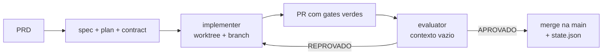

# Como o projeto foi construído por agentes

<!-- TOC -->

- [Como o projeto foi construído por agentes](#como-o-projeto-foi-construído-por-agentes)
  - [Analogia: o cozinheiro e o crítico](#analogia-o-cozinheiro-e-o-crítico)
  - [Ciclo de cada feature](#ciclo-de-cada-feature)
  - [Waves (paralelismo com worktrees)](#waves-paralelismo-com-worktrees)
  - [Regras que mantêm a avaliação honesta](#regras-que-mantêm-a-avaliação-honesta)

<!-- TOC -->

## Analogia: o cozinheiro e o crítico

Quem cozinha não dá nota ao próprio prato. O **implementador** (cozinheiro) segue a receita (spec + plano) e entrega o prato (PR). O **avaliador** (crítico) chega sem saber nada da cozinha, só com o cardápio prometido (contrato), prova cada item e escreve a crítica (relatório). Se algo vier errado, o prato volta para a cozinha e o crítico prova de novo — escrevendo **uma crítica nova**, sem apagar a antiga.

## Ciclo de cada feature

## Waves (paralelismo com worktrees)

```mermaid
gantt
    dateFormat HH:mm
    axisFormat %H:%M
    section W1
    F01 Fundação           :done, 23:00, 20m
    section W2
    F02 Eventos            :done, 23:26, 3m
    F03 Compra e pagamento :done, 23:25, 5m
    section W3
    F04 Vitrine            :done, 23:39, 5m
    F05 API de parceiros   :done, 23:39, 9m
    section W4
    F06 Check-in           :done, 00:01, 6m
    F07 Cancelamento       :done, 00:01, 8m
    section W5
    F08 Painel             :active, 00:36, 10m
    F09 Observabilidade    :active, 00:36, 15m
```

- Cada feature de uma wave paralela roda num **git worktree** próprio, com `COMPOSE_PROJECT_NAME` e portas próprios, para que dois ambientes Docker convivam.
- O primeiro commit é feito cedo e enviado ao GitHub: assim, o primeiro commit de cada PR fica antes do último commit do outro (prova de paralelismo).
- A integração junta a `main` na branch, resolve conflitos (ex.: `scripts/evaluator-flow.sh` na W4), roda os gates e o fluxo, e só então faz o merge.

## Regras que mantêm a avaliação honesta

| Regra | Onde |
| --- | --- |
| Avaliador é um subagente novo, de contexto vazio | [.claude/agents/evaluator.md](../../.claude/agents/evaluator.md) |
| Implementador nunca escreve relatório | [.claude/agents/implementer.md](../../.claude/agents/implementer.md) |
| Relatório é commitado uma vez e nunca alterado | `make check-reports` |
| Sem evidência = REPROVADO | evaluator.md |
| Estado do projeto aponta para o relatório mais recente | [state/project-state.json](../../state/project-state.json) |

Exemplo real: a F07 foi **reprovada** na primeira avaliação porque o item de check-in em evento cancelado dependia da F06, que ainda não estava na branch. Depois da integração com a F06, um novo avaliador aprovou — e os dois relatórios continuam no repositório.
