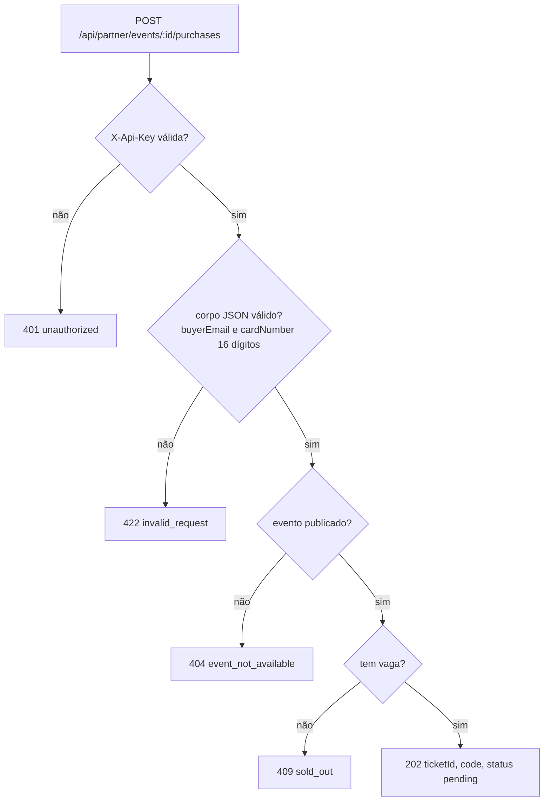

# API de parceiros

<!-- TOC -->

- [API de parceiros](#api-de-parceiros)
  - [Analogia: o porteiro que confere o crachá](#analogia-o-porteiro-que-confere-o-crachá)
  - [Diagrama da compra](#diagrama-da-compra)
  - [Rotas](#rotas)

<!-- TOC -->

## Analogia: o porteiro que confere o crachá

Antes de qualquer conversa, o porteiro confere o crachá (`X-Api-Key`). Sem crachá válido, a resposta é sempre a mesma: "não autorizado" (`401`), não importa o que você esteja carregando. Com crachá, ele confere o pedido **na ordem**: o formulário está preenchido direito? (`422`) O show existe e está à venda? (`404`) Ainda tem lugar? (`409`).

## Diagrama da compra



## Rotas

| Rota | Sucesso | Erros |
| --- | --- | --- |
| `GET /api/partner/events` | `200` lista de `{id, name, startsAt, priceCents, availableSeats}` (só publicados) | `401` |
| `POST /api/partner/events/{id}/purchases` | `202 {ticketId, code, status:"pending"}` | `401`, `422`, `404`, `409` |
| `GET /api/partner/tickets/{id}` | `200 {ticketId, code, eventId, status, checkedIn}` | `401`, `404 ticket_not_found` |

Documentação interativa: `http://localhost:8080/api/docs` (Swagger; botão **Authorize** com a chave `catraca-partner-key-dev`).

```bash
curl -s -H "X-Api-Key: catraca-partner-key-dev" http://localhost:8080/api/partner/events
```
