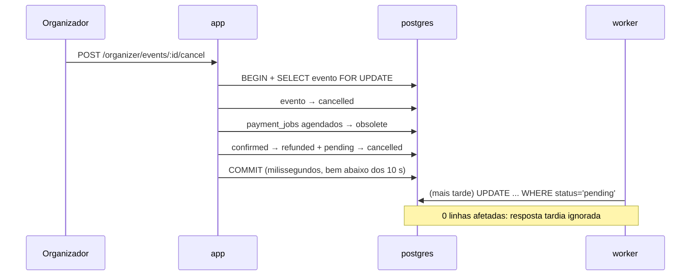

# Cancelamento de evento (R11)

<!-- TOC -->

- [Cancelamento de evento (R11)](#cancelamento-de-evento-r11)
  - [Analogia: o show cancelado](#analogia-o-show-cancelado)
  - [Diagrama](#diagrama)
  - [O que muda em cada feature](#o-que-muda-em-cada-feature)

<!-- TOC -->

## Analogia: o show cancelado

O produtor anuncia o cancelamento: a bilheteria fecha na hora, quem **já pagou** recebe o dinheiro de volta (estorno) e quem **ainda esperava a maquininha** tem o pedido rasgado. Se a maquininha disser "aprovado" depois disso, o recibo vai para o lixo. E o cartaz do show nunca mais volta para a parede.

## Diagrama

## O que muda em cada feature

| Onde | Efeito |
| --- | --- |
| Vitrine e API | O evento some da listagem; compra pela API → `404 event_not_available` |
| Página de gestão | Sem edição, sem publicar, sem cancelar de novo; aviso "Evento cancelado em …" |
| Check-in | Qualquer ingresso do evento → "Evento cancelado" |
| Painel | Confirmados 0, Pendentes 0, Vagas 0, Receita R$ 0,00, Estornados = confirmados anteriores |
