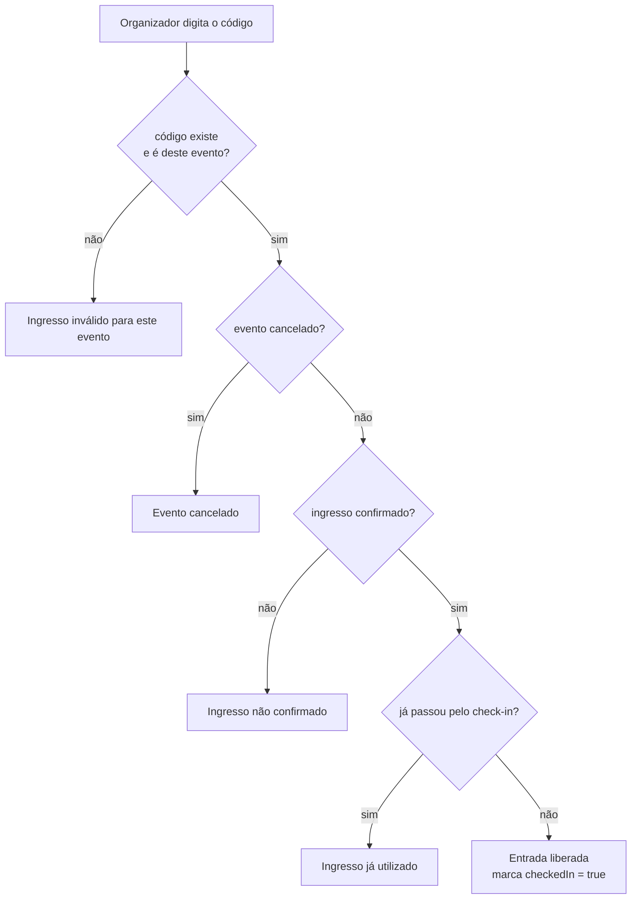

# Check-in (R10)

<!-- TOC -->

- [Check-in (R10)](#check-in-r10)
  - [Analogia: o segurança na porta](#analogia-o-segurança-na-porta)
  - [Diagrama](#diagrama)
  - [Como o código garante isso](#como-o-código-garante-isso)

<!-- TOC -->

## Analogia: o segurança na porta

O segurança tem uma lista e **sempre a lê de cima para baixo**, parando na primeira linha que se aplica. Não adianta o ingresso estar pago se ele é de outro show; não adianta ser deste show se o show foi cancelado.

## Diagrama

## Como o código garante isso

- `decideCheckin()` (`src/domain/checkin.ts`) é uma função **pura** com a ordem acima — fácil de testar (`tests/unit/checkin.test.ts`).
- `checkIn()` trava a linha do ingresso (`SELECT ... FOR UPDATE`): dez cliques simultâneos no mesmo código geram **uma** "Entrada liberada" e nove "Ingresso já utilizado".
- O formulário fica na página de gestão do evento e só o dono o usa (R13).
