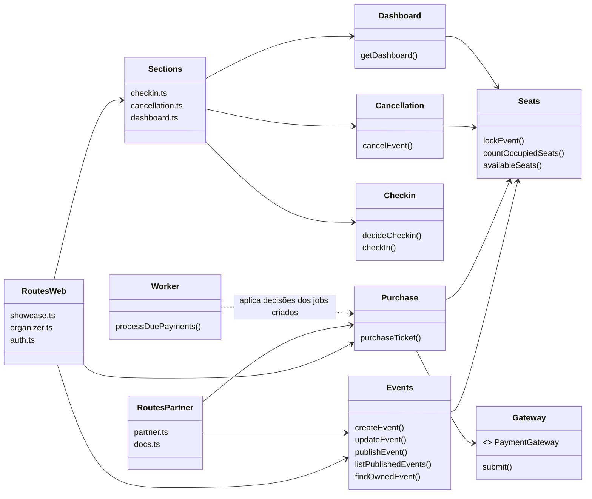

# Módulos e "classes"

<!-- TOC -->

- [Módulos e "classes"](#módulos-e-classes)
  - [Analogia: departamentos de uma empresa](#analogia-departamentos-de-uma-empresa)
  - [Diagrama](#diagrama)
  - [Regras de dependência](#regras-de-dependência)

<!-- TOC -->

## Analogia: departamentos de uma empresa

O **atendimento** (rotas) fala com o cliente e encaminha o pedido. Os **departamentos** (domínio) conhecem as regras: vendas, portaria, cancelamentos. O **arquivo central** (banco) guarda tudo. Um departamento nunca atende o cliente direto, e o atendimento nunca decide uma regra — por isso a mesma regra vale para o site e para a API.

## Diagrama

O projeto usa módulos com funções (não classes), mas o diagrama abaixo mostra cada módulo como uma "classe" para visualizar dependências.

## Regras de dependência

- Rotas só chamam o domínio; o domínio nunca importa rotas.
- Vagas (R05) são calculadas **apenas** em `src/domain/seats.ts`.
- O gateway é uma interface (`PaymentGateway`): trocar o simulado por um real não muda o domínio.
- A página de gestão é extensível por **seções** (`src/app/manage-sections.ts`): check-in, cancelamento e painel entraram sem editar os arquivos da F02.
