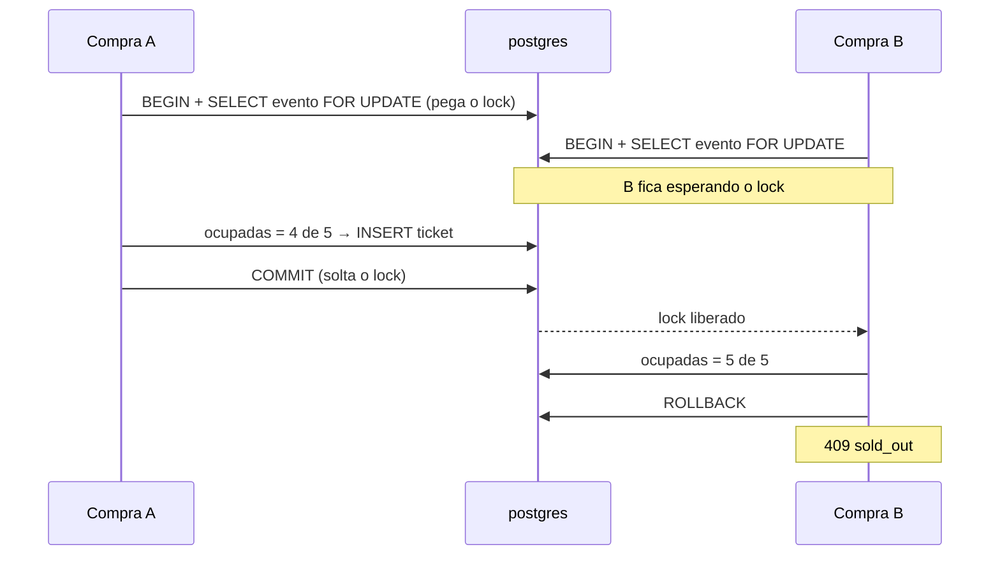

# Concorrência: lotação nunca estoura (R07)

<!-- TOC -->

- [Concorrência: lotação nunca estoura (R07)](#concorrência-lotação-nunca-estoura-r07)
  - [O problema](#o-problema)
  - [Analogia: a catraca física](#analogia-a-catraca-física)
  - [Diagrama: duas compras disputando a última vaga](#diagrama-duas-compras-disputando-a-última-vaga)
  - [Quem usa o mesmo lock](#quem-usa-o-mesmo-lock)
  - [Rede de segurança](#rede-de-segurança)
  - [Como provamos](#como-provamos)

<!-- TOC -->

## O problema

Na primeira tentativa do MVP, um show de 100 lugares vendeu 112 ingressos. Isso acontece quando duas compras leem "falta 1 vaga" **ao mesmo tempo** e as duas inserem um ingresso.

## Analogia: a catraca física

Numa catraca de metrô, só uma pessoa gira o braço por vez. Quem chega junto espera a vez. Aqui, o "braço da catraca" é o **lock da linha do evento** no banco: `SELECT ... FROM events WHERE id = $1 FOR UPDATE`. Enquanto uma compra segura o lock, a próxima compra do **mesmo evento** espera; compras de eventos diferentes não se atrapalham.

## Diagrama: duas compras disputando a última vaga

## Quem usa o mesmo lock

| Operação | Arquivo | Por quê |
| --- | --- | --- |
| Compra | `src/domain/purchase.ts` | Conta vagas e insere sem corrida |
| Editar lotação | `src/domain/events.ts` | Não deixa reduzir abaixo das ocupadas enquanto alguém compra (R03) |
| Cancelar evento | `src/domain/cancellation.ts` | Nenhuma compra "escapa" do cancelamento (R11) |

## Rede de segurança

Um *trigger* no banco (`tickets_capacity_guard`, em `001_init.sql`) recusa qualquer ingresso `pending`/`confirmed` que ultrapasse a lotação. O caminho normal nunca o dispara; ele existe para transformar um esquecimento do lock em erro, e não em venda a mais.

## Como provamos

- Teste de domínio: 20 eventos novos de lotação 5 × 30 compras simultâneas → sempre 5; e 200 compras em lotação 37 → 37 (`tests/integration/concurrency-core.test.ts`).
- Teste HTTP: 6 eventos × 30 POSTs simultâneos → 5×`202` e 25×`409` (`tests/integration/concurrency-api.test.ts`).
- Fluxo do avaliador, passo 15, com o comando literal `seq 30 | xargs -P 30 ... curl` (`make evaluator-flow`).
