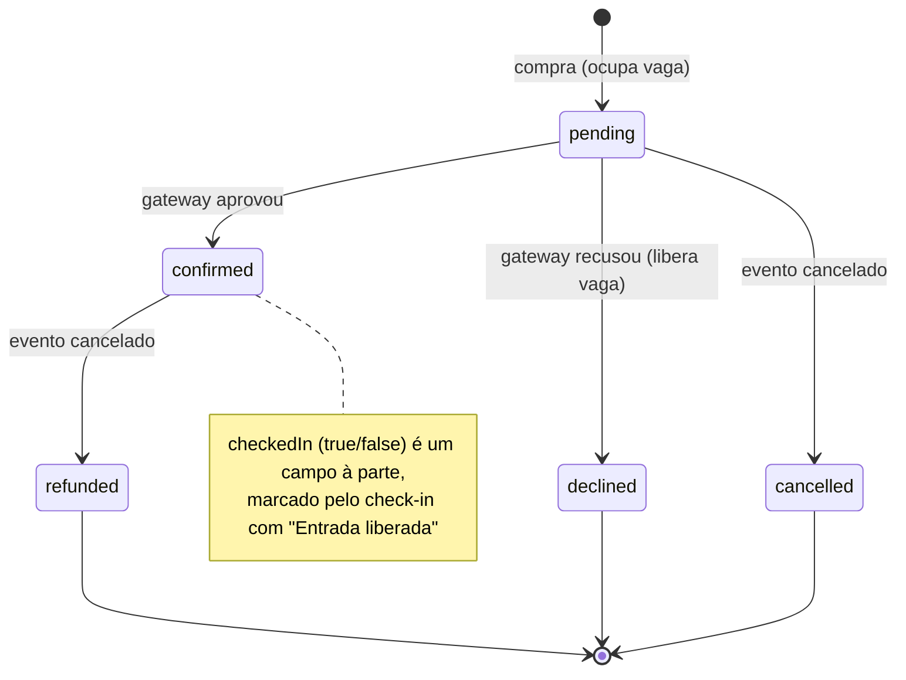

# Estados do ingresso

<!-- TOC -->

- [Estados do ingresso](#estados-do-ingresso)
  - [Analogia: a etiqueta da bagagem](#analogia-a-etiqueta-da-bagagem)
  - [Diagrama](#diagrama)

<!-- TOC -->

## Analogia: a etiqueta da bagagem

No aeroporto a mala recebe uma etiqueta que muda de cor conforme a viagem: "aguardando" → "embarcada" ou "recusada". Se o voo for cancelado, a mala embarcada é **devolvida** (estorno) e a que ainda aguardava é **cancelada**. Passar pelo raio-X (check-in) não muda a cor da etiqueta: é um carimbo à parte.

## Diagrama

| Valor na API | Rótulo na tela | Ocupa vaga? | Conta na receita? |
| --- | --- | --- | --- |
| `pending` | pendente | sim | não |
| `confirmed` | confirmado | sim | **sim** (preço do momento da compra) |
| `declined` | recusado | não | não |
| `cancelled` | cancelado | não | não |
| `refunded` | estornado | não | não (aparece em "Estornados") |

Regra de ouro: **só o worker muda `pending` por causa do gateway, e só se ainda estiver `pending`**. Por isso uma resposta tardia não "ressuscita" um ingresso cancelado.
