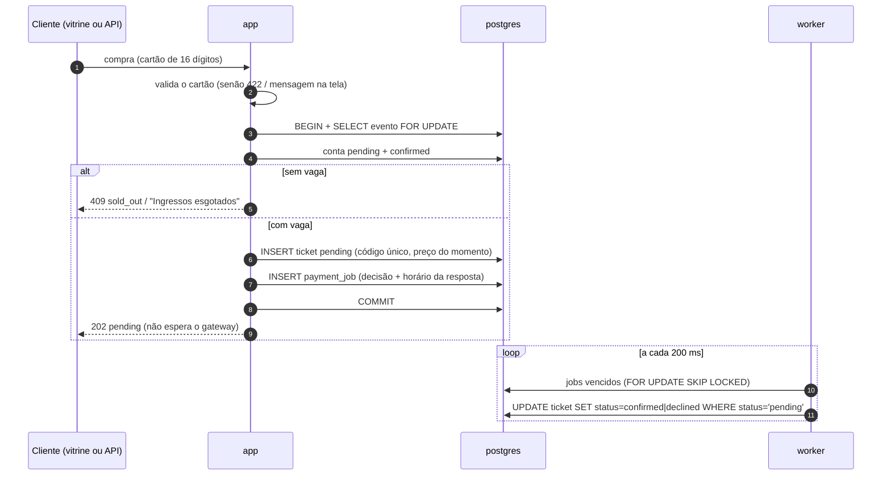

# Fluxo de compra (R05, R06, R08, R09)

<!-- TOC -->

- [Fluxo de compra (R05, R06, R08, R09)](#fluxo-de-compra-r05-r06-r08-r09)
  - [Analogia: a comanda do restaurante](#analogia-a-comanda-do-restaurante)
  - [Diagrama](#diagrama)
  - [Detalhes importantes](#detalhes-importantes)

<!-- TOC -->

## Analogia: a comanda do restaurante

Você pede um prato e o garçom **entrega a comanda na hora** (ingresso `pending`), sem esperar a cozinha. A comanda já "reserva" seu lugar na mesa (vaga ocupada). Minutos depois a cozinha avisa: prato saiu (`confirmed`) ou acabou o ingrediente (`declined`, e a mesa é liberada). Se o restaurante fechar antes do prato sair, a comanda é rasgada (`cancelled`) — e o aviso que a cozinha mandar depois é jogado fora.

## Diagrama

## Detalhes importantes

- **Gateway simulado** (`src/gateway/simulated-gateway.ts`): final `0001` aprova em 2–4,5 s; `0002` recusa em 2–4,5 s; `0003` aprova em 30–39 s; `0004` recusa em 30–39 s; outros finais recusam em 2–4,5 s. As faixas ficam dentro das do brief com folga para o *polling* do worker.
- **Preço congelado**: o ingresso guarda `price_cents` do momento da compra; mudar o preço do evento depois não altera compras anteriores (R03, R12).
- **O número do cartão nunca é salvo**: só os 4 últimos dígitos.
- **Por que um worker separado?** A resposta do gateway pode demorar 40 s; a compra precisa responder na hora (R06). Guardar a "resposta futura" numa tabela (`payment_jobs`) faz o sistema sobreviver a reinícios: nada se perde se o contêiner cair.
