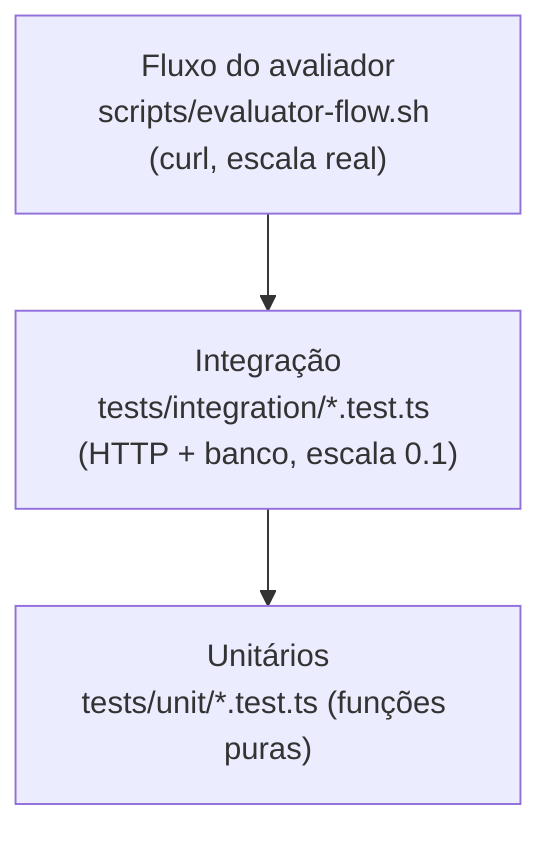
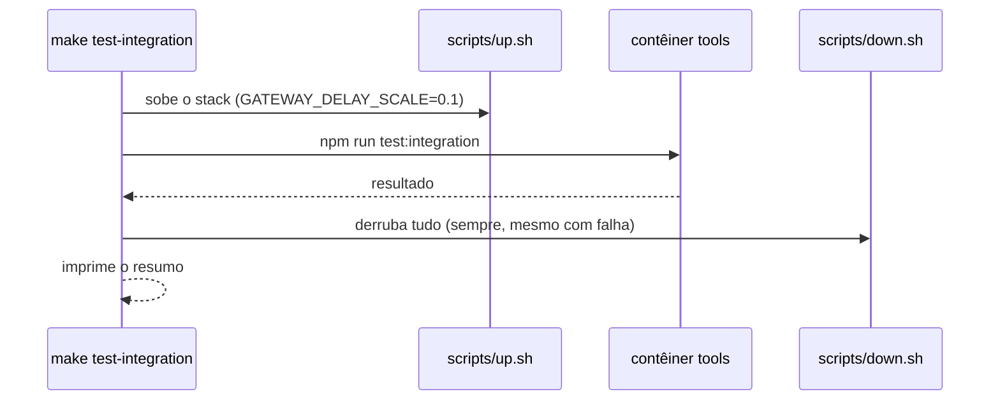

# Testes

<!-- TOC -->

- [Testes](#testes)
  - [Analogia: o ensaio geral](#analogia-o-ensaio-geral)
  - [Pirâmide](#pirâmide)
  - [Como rodar](#como-rodar)

<!-- TOC -->

## Analogia: o ensaio geral

Antes da estreia a banda ensaia cada música sozinha (testes **unitários**: funções puras, sem banco), depois ensaia o show inteiro no palco de verdade (testes de **integração**: app, worker e banco rodando em contêineres) e, por fim, faz a passagem de som com o público imaginário seguindo o roteiro oficial (**fluxo do avaliador** com `curl`).

## Pirâmide

## Como rodar

| Comando | O que roda |
| --- | --- |
| `make test-unit` | up → unitários → down |
| `make test-integration` | up → integração → down |
| `make test` | up → lint, typecheck, unitários, integração → down |
| `make gates` | spec, relatórios, TOC + `make test` |
| `make evaluator-flow` | Fluxo do avaliador contra o stack já no ar (`FAST=1` encurta o passo 8) |

Os testes rodam **dentro de um contêiner** (`tools`), então o host não precisa de Node para testar. A escala `0.1` do gateway só existe nos testes; o modo padrão do produto usa os tempos do brief.
