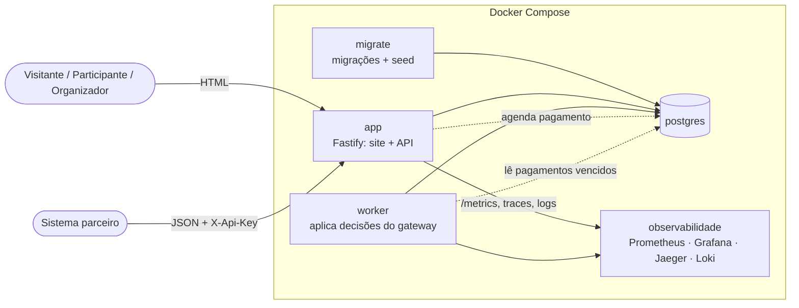

# Visão geral

<!-- TOC -->

- [Visão geral](#visão-geral)
  - [Analogia: uma casa de shows](#analogia-uma-casa-de-shows)
  - [Diagrama](#diagrama)
  - [Como as peças se encontram](#como-as-peças-se-encontram)

<!-- TOC -->

## Analogia: uma casa de shows

Imagine uma casa de shows pequena:

- A **bilheteria** atende o público e os revendedores → é o serviço `app` (site + API de parceiros).
- O **cofre com o livro de vendas** guarda tudo que foi vendido → é o `postgres`.
- A **maquininha de cartão** demora alguns segundos para dizer "aprovado" ou "recusado" → é o gateway simulado.
- O **caixa dos fundos** confere os comprovantes que a maquininha devolve e atualiza o livro → é o `worker`.
- O **zelador que abre a casa** de manhã (cria as tabelas e as contas de teste) e vai embora → é o `migrate`.
- As **câmeras e o livro de ocorrências** → Prometheus, Grafana, Jaeger e Loki (observabilidade).

## Diagrama

## Como as peças se encontram

| Peça | Arquivo/serviço | Responsabilidade |
| --- | --- | --- |
| Site | `src/app/routes/{auth,showcase,organizer}.ts` + `src/app/views` | Páginas HTML (vitrine, meus ingressos, gestão) |
| API de parceiros | `src/app/routes/partner.ts` | Contrato fixo em JSON |
| Regras de negócio | `src/domain/*.ts` | Vagas, compra, check-in, cancelamento, painel |
| Gateway simulado | `src/gateway/*.ts` | Decide pelo final do cartão e quando "responde" |
| Worker | `src/worker/*.ts` | Aplica a decisão do gateway no ingresso |
| Banco | `src/db/migrations/*.sql` | Tabelas, índices e o *trigger* de lotação |

Tudo sobe com `make up` e cai com `make down` (veja o [README](../../README.md)).
