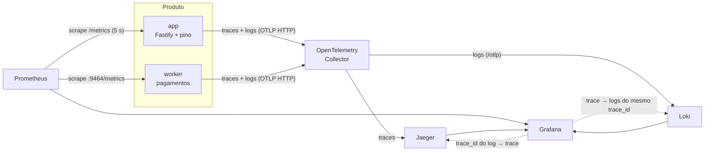

# Observabilidade: métricas, traces e logs

<!-- TOC -->

- [Observabilidade: métricas, traces e logs](#observabilidade-métricas-traces-e-logs)
  - [Para que serve](#para-que-serve)
  - [Ferramentas, URLs e portas](#ferramentas-urls-e-portas)
  - [Como os dados fluem](#como-os-dados-fluem)
  - [Métricas expostas](#métricas-expostas)
  - [Painéis no Grafana](#painéis-no-grafana)
  - [Correlacionando métricas, traces e logs](#correlacionando-métricas-traces-e-logs)
  - [Verificação rápida](#verificação-rápida)
  - [Problemas comuns](#problemas-comuns)

<!-- TOC -->

## Para que serve

A observabilidade responde a três perguntas sobre o Catraca rodando:

1. **Quanto e com que frequência?** (métricas) — quantos ingressos foram vendidos, quantas compras foram recusadas por esgotado, quantas confirmações estão pendentes, qual a receita, quanto o gateway de pagamento demora.
2. **Por onde passou esta requisição?** (traces) — a sequência de passos de uma compra: requisição HTTP → transação no banco → `INSERT` do ingresso → `COMMIT`, com o tempo de cada passo.
3. **O que o sistema disse naquele momento?** (logs) — as mensagens estruturadas (JSON) do app e do worker, cada uma marcada com o `trace_id` da requisição que a gerou.

O avaliador não precisa abrir os painéis: eles servem para entender e diagnosticar o produto. Nenhuma regra de negócio depende desta parte (com `OBSERVABILITY=0` o produto funciona igual).

> Analogia: é o **painel de um carro**. O **velocímetro e os mostradores** (métricas) dizem a velocidade e o combustível agora; o **GPS com o trajeto da viagem** (traces) mostra por quais ruas você passou e quanto tempo ficou em cada uma; o **diário de bordo** (logs) registra o que aconteceu em cada parada. Quando algo estranho aparece no velocímetro, você abre o trajeto daquele momento e depois lê a anotação do diário — é exatamente a correlação métricas → traces → logs.

## Ferramentas, URLs e portas

Sobem com `make up` (padrão `OBSERVABILITY=1`, perfil `observability` do Compose) e caem com `make down`.

| Ferramenta | Para que serve | URL padrão | Variável da porta |
| --- | --- | --- | --- |
| Grafana | Painéis e exploração (métricas, logs e traces juntos). Login `admin` / `admin`; leitura anônima liberada | <http://localhost:3000> | `GRAFANA_PORT` |
| Prometheus | Banco de métricas: coleta (*scrape*) `/metrics` do app e do worker a cada 5 s | <http://localhost:9090> | `PROMETHEUS_PORT` |
| Jaeger | Traces: o caminho de cada requisição, passo a passo | <http://localhost:16686> | `JAEGER_UI_PORT` |
| Loki | Logs estruturados (consultados pelo Grafana) | <http://localhost:3100> | `LOKI_PORT` |
| OpenTelemetry Collector | "Carteiro": recebe traces e logs do app/worker (OTLP HTTP, porta interna 4318) e entrega ao Jaeger e ao Loki | interno | — |

Endpoints de métricas (formato texto do Prometheus):

- App: `http://localhost:${APP_PORT:-8080}/metrics`
- Worker: `http://worker:9464/metrics` (porta interna da rede do Compose; o Prometheus e o contêiner de testes acessam por esse nome)

Versões das imagens: [imagens.md](imagens.md).

## Como os dados fluem



- **Traces**: `src/observability/otel.ts` é carregado antes do app/worker (`node --import ./src/observability/otel.ts ...`) e liga o SDK do OpenTelemetry com instrumentação automática de HTTP, `pg` (consultas ao banco) e `pino` (logs). Consultas ao banco só viram *span* dentro de uma requisição, para o *polling* do worker não inundar o Jaeger.
- **Logs**: o pino continua escrevendo JSON no `stdout` (`make logs`); com o SDK ligado, cada linha ganha `trace_id`/`span_id` e também é enviada ao Collector, que a entrega ao Loki pelo endpoint OTLP nativo. No Loki, o nome do serviço vira o rótulo `service_name` (`catraca-app`, `catraca-worker`).
- **Métricas**: `src/observability/metrics.ts` (prom-client). Contadores e histogramas são por processo; os mostradores de estado (ingressos por status, pendentes, receita, fila do worker) são lidos do banco a cada *scrape*, então mostram a verdade mesmo com vários processos ou após um reinício.
- **Desligado** (`OBSERVABILITY=0`): o `up.sh` define `OTEL_SDK_DISABLED=true`, o `otel.ts` não carrega nada e nada tenta se conectar ao Collector (sem erros no log). O `/metrics` continua disponível.

## Métricas expostas

| Métrica | Tipo | Rótulos | O que mede |
| --- | --- | --- | --- |
| `catraca_tickets_created_total` | counter | `channel` (`web`, `partner`) | Ingressos criados (pendentes) por canal |
| `catraca_purchases_rejected_total` | counter | `reason` (`sold_out`, `event_not_available`, `invalid_card`, `invalid_request`) | Compras recusadas antes de criar ingresso |
| `catraca_gateway_calls_total` | counter | `outcome` (`approved`, `declined`), `applied` (`true`/`false`) | Respostas do gateway processadas pelo worker; `applied=false` = resposta tardia ignorada (ex.: evento cancelado) |
| `catraca_gateway_latency_seconds` | histogram | `outcome` | Tempo entre a criação do ingresso e a aplicação da resposta do gateway |
| `catraca_checkins_total` | counter | `result` (`ok`, `alreadyUsed`, `notConfirmed`, `cancelled`, `invalid`) | Tentativas de check-in |
| `catraca_events_cancelled_total` | counter | — | Eventos cancelados |
| `catraca_tickets_by_status` | gauge | `status` | Ingressos por status (lido do banco) |
| `catraca_pending_confirmations` | gauge | — | Ingressos aguardando o gateway |
| `catraca_revenue_cents` | gauge | — | Receita: soma dos preços dos ingressos confirmados |
| `catraca_payment_jobs_due` | gauge | — | Fila do worker: jobs de pagamento vencidos e não processados |
| `http_request_duration_seconds` | histogram | `method`, `route`, `status_code` | Duração das requisições HTTP do app, por modelo de rota |

Também saem as métricas padrão do Node.js (memória, CPU, *event loop*) do prom-client. Todas as séries do processo levam o rótulo `service`.

O pedido de medir "número de chamadas ao modelo" foi interpretado como **chamadas ao provedor externo** do domínio — o gateway de pagamento (`catraca_gateway_calls_total`) —, porque o produto não chama nenhum modelo de IA.

## Painéis no Grafana

Pasta **Catraca** (provisionados de `docker/grafana/dashboards/`, atualizam a cada 5 s):

- **Catraca — Negócio**: ingressos criados, aguardando confirmação, receita confirmada, recusas por esgotado, estornados/cancelados, eventos cancelados, vendas por canal, recusas por motivo, ingressos por status, check-ins por resultado, chamadas ao gateway e latência do gateway (p50/p95).
- **Catraca — Técnico**: requisições por segundo por rota, latência p50/p95 por rota, erros 5xx, fila do worker, memória, *event loop lag*, alvos do Prometheus e logs recentes (Loki).

Datasources provisionados (`docker/grafana/provisioning/datasources/`): **Prometheus** (padrão, uid `prometheus`), **Loki** (uid `loki`, com link do `trace_id` para o Jaeger) e **Jaeger** (uid `jaeger`, com link do trace para os logs no Loki filtrados pelo mesmo `trace_id`).

## Correlacionando métricas, traces e logs

Exemplo: "a latência da rota de compra subiu".

1. **Métrica**: no painel *Catraca — Técnico*, o gráfico *Latência por rota* mostra o pico em `POST /api/partner/events/:eventId/purchases`.
2. **Trace**: no Grafana, *Explore* → Jaeger → *Search*, serviço `catraca-app`, operação `POST`, no mesmo intervalo; abra um trace lento e veja qual passo demorou (ex.: `pg.query:SELECT` esperando o *lock* do evento). No trace, o botão de logs abre as linhas do Loki com o mesmo `trace_id`.
3. **Log**: no painel *Logs recentes* (ou *Explore* → Loki, `{service_name="catraca-app"}`), abra uma linha: o campo `trace_id` tem o link **Ver trace no Jaeger**, que faz o caminho inverso.

Consultas úteis:

```text
# Prometheus
sum by (reason) (catraca_purchases_rejected_total)
sum(catraca_gateway_calls_total)
histogram_quantile(0.95, sum by (le, route) (rate(http_request_duration_seconds_bucket[5m])))

# Loki (LogQL)
{service_name="catraca-app"} | trace_id="<trace_id>"
{service_name="catraca-worker"} |= "payment processed"
```

## Verificação rápida

Com o ambiente no ar (`make up`) e as portas padrão:

```bash
curl -s localhost:9090/-/ready                                   # Prometheus pronto
curl -s localhost:9090/api/v1/targets | grep -o '"health":"[a-z]*"'   # app e worker "up"
curl -s localhost:3000/api/health                                # Grafana
curl -s localhost:3000/api/datasources | grep -o '"name":"[A-Za-z]*"' # Prometheus, Loki, Jaeger
curl -s 'localhost:3000/api/search?query=Catraca'                # os 2 painéis
curl -s localhost:3100/ready                                     # Loki
curl -s localhost:8080/metrics | grep '^catraca_'                # métricas do app
```

Para achar um trace a partir de um log: `make logs SERVICE=app` mostra o `trace_id` de cada linha; depois `curl -s localhost:16686/api/traces/<trace_id>`.

## Problemas comuns

| Sintoma | Causa provável | Como resolver |
| --- | --- | --- |
| Painéis vazios logo após subir | O Prometheus ainda não fez dois *scrapes* (gráficos de taxa precisam de 2 amostras) | Aguarde ~15 s e gere tráfego (uma compra) |
| Sem traces/logs no Jaeger/Loki | Subiu com `OBSERVABILITY=0` (SDK desligado) | `make down && make up` (padrão `OBSERVABILITY=1`) |
| Alvo `catraca-worker` *down* no Prometheus | Worker reiniciando ou fora do ar | `make logs SERVICE=worker` |
| Porta 3000/9090/16686/3100 ocupada | Outro programa usa a porta | Ajuste `GRAFANA_PORT`, `PROMETHEUS_PORT`, `JAEGER_UI_PORT`, `LOKI_PORT` ([configuracao.md](configuracao.md)) |
| Contadores "voltaram a zero" | Contadores são por processo e zeram quando o processo reinicia | Use `increase()`/`rate()` (o Prometheus trata reinícios) ou os mostradores lidos do banco |
