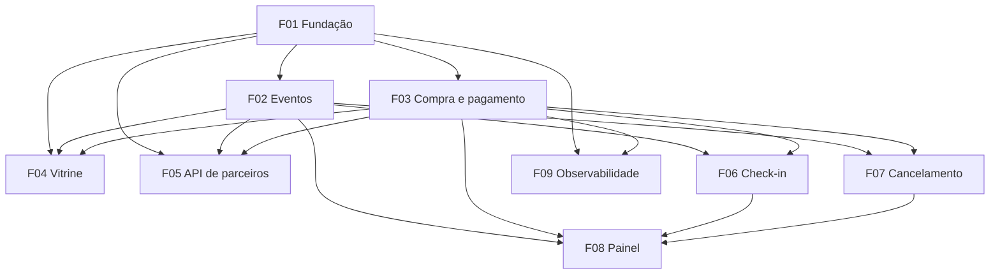

# PRD — Catraca MVP

<!-- TOC -->

- [PRD — Catraca MVP](#prd--catraca-mvp)
  - [1. Contexto e objetivo](#1-contexto-e-objetivo)
  - [2. Personas](#2-personas)
  - [3. Glossário](#3-glossário)
  - [4. Features](#4-features)
    - [F01 — Fundação (harness, schema, contas e autenticação)](#f01--fundação-harness-schema-contas-e-autenticação)
    - [F02 — Gestão de eventos do organizador](#f02--gestão-de-eventos-do-organizador)
    - [F03 — Núcleo de compra e pagamento](#f03--núcleo-de-compra-e-pagamento)
    - [F04 — Vitrine e área do participante](#f04--vitrine-e-área-do-participante)
    - [F05 — API de parceiros + OpenAPI](#f05--api-de-parceiros--openapi)
    - [F06 — Check-in](#f06--check-in)
    - [F07 — Cancelamento de evento](#f07--cancelamento-de-evento)
    - [F08 — Painel do evento](#f08--painel-do-evento)
    - [F09 — Observabilidade](#f09--observabilidade)
  - [5. Grafo de dependências](#5-grafo-de-dependências)
  - [6. Waves](#6-waves)
  - [7. Critérios de aceite por feature](#7-critérios-de-aceite-por-feature)
    - [F01](#f01)
    - [F02](#f02)
    - [F03](#f03)
    - [F04](#f04)
    - [F05](#f05)
    - [F06](#f06)
    - [F07](#f07)
    - [F08](#f08)
    - [F09](#f09)
  - [8. Critérios cross-feature](#8-critérios-cross-feature)
  - [9. Rastreabilidade das regras](#9-rastreabilidade-das-regras)
  - [10. Fora de escopo](#10-fora-de-escopo)

<!-- TOC -->

## 1. Contexto e objetivo

A Catraca vende ingressos para eventos pequenos (shows em bar, workshops, meetups). A primeira tentativa de MVP falhou porque cada feature funcionava sozinha e quebrava ao encontrar as outras (evento cancelado deixando entrar, estorno somado como receita, 112 ingressos vendidos em um show de 100 lugares).

Este PRD transforma o brief do [TASK.md](../../TASK.md) (regras R01–R13) em features com dependências explícitas (`Provides`/`Consumes`), waves de entrega e **critérios de aceite cross-feature** que provam que o que uma feature entrega chega e funciona na que consome.

Fonte da verdade: `TASK.md` → este PRD → `docs/features/F0X-*/{spec,plan,contract}.md`.

## 2. Personas

| Persona | Como entra | O que faz |
| --- | --- | --- |
| Visitante | Sem login | Vê a vitrine de eventos publicados |
| Participante | Cria a própria conta (nome, e-mail, senha) | Entra, sai, compra ingressos, vê "Meus ingressos" |
| Organizador | Conta vinda da seed (sem cadastro pelo produto) | Cria, edita, publica, cancela os próprios eventos; faz check-in; vê o painel |
| Parceiro | Chave no cabeçalho `X-Api-Key` | Lista eventos à venda, compra e consulta ingressos pela API |

## 3. Glossário

- **Vagas ocupadas**: ingressos `pending` + `confirmed` do evento (R05).
- **Vagas disponíveis**: lotação − vagas ocupadas; zero em evento cancelado (R05).
- **Página de gestão**: `/organizer/events/{id}`, onde o organizador edita, publica, cancela, faz check-in e vê o painel (R04).
- **Status do ingresso**: `pending` (pendente), `confirmed` (confirmado), `declined` (recusado), `cancelled` (cancelado), `refunded` (estornado). `checkedIn` é campo à parte.
- **Status do evento**: `draft` (rascunho), `published` (publicado), `cancelled` (cancelado).

## 4. Features

### F01 — Fundação (harness, schema, contas e autenticação)

- **Provides**: ambiente (`make up`/`make down`/`make gates`), Docker Compose, schema completo do banco (users, sessions, events, tickets, payment_jobs, partners), migrações, seed idempotente (organizador A, organizador B, participante, parceiro), cadastro/login/logout de participante, login de organizador, sessão por cookie, guardas `requireParticipant`/`requireOrganizer`, layout HTML, helpers `lockEvent`/`countOccupiedSeats`/`availableSeats` (R05), helpers de teste.
- **Consumes**: —

### F02 — Gestão de eventos do organizador

- **Provides**: criar/editar/publicar evento (R01–R03), lista "Meus eventos" do organizador, página de gestão com URL própria e seções extensíveis (R04), isolamento por organizador `findOwnedEvent` (R13), `listPublishedEvents()` com vagas disponíveis.
- **Consumes**: F01 (schema, sessão, `requireOrganizer`, `lockEvent`/`countOccupiedSeats`).

### F03 — Núcleo de compra e pagamento

- **Provides**: `purchaseTicket()` única para todos os canais (validação do cartão, lock do evento, checagem de vaga, criação do ingresso `pending` com código único e preço vigente, agendamento do pagamento), gateway simulado com a tabela de finais, worker que aplica a decisão só em ingresso ainda `pending` (R06–R09, R03 preço), consultas de ingresso.
- **Consumes**: F01 (schema, `lockEvent`, `countOccupiedSeats`, Compose para o worker).

### F04 — Vitrine e área do participante

- **Provides**: vitrine pública de eventos à venda, página do evento com compra (cartão) ou `Ingressos esgotados`, "Meus ingressos" (evento, status, código).
- **Consumes**: F01 (sessão de participante), F02 (`listPublishedEvents`, eventos publicados), F03 (`purchaseTicket`, consultas de ingresso).

### F05 — API de parceiros + OpenAPI

- **Provides**: `GET /api/partner/events`, `POST /api/partner/events/{eventId}/purchases`, `GET /api/partner/tickets/{ticketId}` no contrato fixo, autenticação `X-Api-Key`, Swagger UI em `/api/docs` e `/api/openapi.json`.
- **Consumes**: F01 (tabela/seed de parceiros), F02 (`listPublishedEvents`), F03 (`purchaseTicket`, consulta de ingresso).

### F06 — Check-in

- **Provides**: formulário de check-in na página de gestão com as mensagens exatas e a ordem de R10; marca `checked_in`.
- **Consumes**: F02 (página de gestão, `findOwnedEvent`), F03 (ingressos e status).

### F07 — Cancelamento de evento

- **Provides**: ação de cancelar (irreversível) na página de gestão: evento sai da vitrine/API, para de vender, não pode ser editado nem republicado; `confirmed → refunded`, `pending → cancelled` na mesma transação; pagamentos agendados ficam obsoletos (R11).
- **Consumes**: F02 (página de gestão, bloqueio de edição), F03 (ingressos, jobs de pagamento, regra "worker só altera `pending`").

### F08 — Painel do evento

- **Provides**: seção do painel na página de gestão com Confirmados, Pendentes, Check-ins, Vagas disponíveis, Receita e Estornados (R12).
- **Consumes**: F02 (página de gestão), F03 (ingressos com preço congelado), F06 (`checked_in`), F07 (`refunded`/evento cancelado).

### F09 — Observabilidade

- **Provides**: OpenTelemetry Collector, Prometheus, Grafana (dashboards de negócio e técnico), Jaeger, Loki; métricas de negócio em `/metrics`; traces e logs correlacionados por `trace_id`.
- **Consumes**: F01 (Compose, app e worker), F03 (eventos de compra e do gateway a medir).

## 5. Grafo de dependências

## 6. Waves

| Wave | Features | Modo | Pré-condição |
| --- | --- | --- | --- |
| W1 | F01 | sequencial | — |
| W2 | F02, F03 | **paralelo** (worktrees, PRs) | W1 na `main` |
| W3 | F04, F05 | **paralelo** (worktrees, PRs) | W2 na `main` |
| W4 | F06, F07 | **paralelo** (worktrees, PRs) | W3 na `main` |
| W5 | F08, F09 | **paralelo** (worktrees, PRs) | W4 na `main` |

Regra de ouro do handoff: uma feature só começa quando tudo que ela consome está na `main` **e aprovado** pelo avaliador.

## 7. Critérios de aceite por feature

Formato: `**ID** (regras): critério verificável`.

### F01

- **F01-AC01** (—): em um clone limpo, `make up` sobe o produto em `$WEB` com a seed carregada, sem nenhum outro passo.
- **F01-AC02** (—): `make down` encerra tudo que a subida iniciou (nenhuma porta responde, nenhum container do projeto rodando) e `make up` de novo funciona, inclusive a seed.
- **F01-AC03** (—): `make gates` roda lint, typecheck, checagens de spec/relatórios/TOC e testes automatizados, e passa.
- **F01-AC04** (R13): o participante cria conta (nome, e-mail, senha), entra e sai; e-mail duplicado é rejeitado; não existe cadastro de organizador pelo produto.
- **F01-AC05** (R13): visitante que acessa `/organizer/*` é enviado ao login; participante recebe 403 sem dados de evento.
- **F01-AC06** (—): a seed cria organizador A, organizador B, participante e parceiro, e pode rodar de novo sem erro.
- **F01-AC07** (—): porta ocupada faz `make up` falhar com `[ERRO][PORT-001]` indicando a variável a trocar; SO fora da matriz falha com `[ERRO][OS-001]`.

### F02

- **F02-AC01** (R01, R02): o organizador cria evento com nome, data/hora, local, lotação (inteiro ≥ 1) e preço (> 0); o evento nasce `draft`.
- **F02-AC02** (R01): data de início no passado é rejeitada ao criar e ao editar; lotação < 1 e preço ≤ 0 são rejeitados.
- **F02-AC03** (R03, R05): reduzir a lotação abaixo das vagas ocupadas é rejeitado; aumentar é aceito.
- **F02-AC04** (R04): cada evento tem página de gestão em `/organizer/events/{id}` com edição e publicação.
- **F02-AC05** (R13): a lista de eventos do organizador mostra só os seus; acessar a página de gestão de evento de outro organizador responde 404 sem nome, números ou ingressos.
- **F02-AC06** (R02): publicar muda `draft → published`; evento cancelado não pode ser editado nem republicado.

### F03

- **F03-AC01** (R06, R09): uma compra cria um ingresso `pending` com código único de 8 caracteres e responde sem esperar o gateway.
- **F03-AC02** (R07): sem vaga disponível a compra é recusada com `sold_out`; 30 compras simultâneas em evento de lotação 5 resultam em exatamente 5 ingressos.
- **F03-AC03** (R08): final `0001` confirma em 2–5 s; `0002` e outros finais recusam em 2–5 s; `0003` confirma e `0004` recusa em 30–40 s.
- **F03-AC04** (R05, R08): ingresso pendente ocupa vaga; a recusa libera a vaga.
- **F03-AC05** (R03): o ingresso guarda o preço vigente no momento da compra.
- **F03-AC06** (R11): o worker só altera ingresso que ainda está `pending`.
- **F03-AC07** (R06): cartão sem exatamente 16 dígitos é rejeitado antes de criar o ingresso; o número do cartão não é persistido (só os 4 últimos dígitos).

### F04

- **F04-AC01** (R02): a vitrine (sem login) lista só eventos publicados e não cancelados.
- **F04-AC02** (R06, R08, R09): o participante compra na vitrine com `4000000000000001`; em "Meus ingressos" o ingresso aparece pendente e, em até 5 s, confirmado, com evento, status e código.
- **F04-AC03** (R07): sem vaga, a página do evento exibe `Ingressos esgotados` no lugar da compra (e como resposta a uma tentativa).
- **F04-AC04** (R06): visitante não compra (é enviado ao login); cartão inválido mostra erro sem criar ingresso.

### F05

- **F05-AC01** (R02, R05): `GET /api/partner/events` lista só publicados não cancelados com `id`, `name`, `startsAt`, `priceCents`, `availableSeats`.
- **F05-AC02** (R06, R09): `POST /api/partner/events/{id}/purchases` válido responde `202` com `ticketId`, `code`, `status: "pending"`.
- **F05-AC03** (R07): erros da compra na ordem: `422 invalid_request` → `404 event_not_available` (inexistente, rascunho ou cancelado) → `409 sold_out`.
- **F05-AC04** (—): sem `X-Api-Key` ou com chave inválida, as três rotas respondem `401 {"error":"unauthorized"}`.
- **F05-AC05** (R08, R09): `GET /api/partner/tickets/{id}` retorna `ticketId`, `code`, `eventId`, `status`, `checkedIn` de qualquer canal; inexistente → `404 ticket_not_found`.
- **F05-AC06** (—): Swagger UI em `/api/docs` e OpenAPI em `/api/openapi.json` descrevem as três rotas, a segurança `X-Api-Key` e os erros.

### F06

- **F06-AC01** (R10): código inexistente ou de outro evento → `Ingresso inválido para este evento`.
- **F06-AC02** (R10, R11): evento cancelado → `Evento cancelado` (avaliado depois da regra 1).
- **F06-AC03** (R10): ingresso não confirmado → `Ingresso não confirmado`.
- **F06-AC04** (R10): ingresso já usado → `Ingresso já utilizado`.
- **F06-AC05** (R10): caso contrário → `Entrada liberada` e o ingresso passa a `checkedIn: true`.
- **F06-AC06** (R13): só o dono do evento faz check-in nele.

### F07

- **F07-AC01** (R11): o organizador cancela um evento publicado; o cancelamento é irreversível.
- **F07-AC02** (R11, R02): evento cancelado sai da vitrine e da listagem da API e não aceita compras.
- **F07-AC03** (R11): em até 10 s, confirmados viram `refunded` e pendentes viram `cancelled`.
- **F07-AC04** (R11): resposta do gateway que chega depois do cancelamento não muda o status.
- **F07-AC05** (R11, R13): a página de gestão de evento cancelado não permite editar, publicar nem cancelar de novo; só o dono cancela.

### F08

- **F08-AC01** (R12): o painel mostra Confirmados (inclui os com check-in), Pendentes, Check-ins, Vagas disponíveis (R05), Receita e Estornados.
- **F08-AC02** (R12, R03): a Receita soma o preço vigente em cada compra confirmada (mudança de preço não altera compras anteriores).
- **F08-AC03** (R12, R05): Vagas disponíveis = lotação − (pendentes + confirmados); 0 em evento cancelado.
- **F08-AC04** (R12, R13): o painel só aparece para o dono do evento.

### F09

- **F09-AC01** (—): com `OBSERVABILITY=1` (padrão), Prometheus, Grafana, Jaeger, Loki e Collector sobem com o `make up` e caem com o `make down`.
- **F09-AC02** (R07, R08, R12): `/metrics` expõe métricas de negócio (ingressos por status, pendentes, recusas `sold_out`, chamadas ao gateway e latência, check-ins, receita, estornos).
- **F09-AC03** (—): Grafana provisiona datasources e dashboards; logs no Loki têm `trace_id` com link para o trace no Jaeger.
- **F09-AC04** (—): `OBSERVABILITY=0 make up` sobe só o produto, que funciona normalmente.

## 8. Critérios cross-feature

Um critério por aresta do grafo (no mínimo). O ID indica `XF-<provedor>-<consumidor>-NN`.

- **XF-F01-F02-01** (R13): organizador da seed entra e acessa "Meus eventos"; participante da seed recebe 403 na área de organizador.
- **XF-F01-F03-01** (R05): `countOccupiedSeats` da F01 conta `pending` + `confirmed` criados pela compra da F03, e o worker da F03 roda como serviço do Compose da F01.
- **XF-F01-F04-01** (R09): participante criado pelo cadastro da F01 compra na vitrine e vê o ingresso em "Meus ingressos".
- **XF-F01-F05-01** (—): a chave de parceiro da seed da F01 é aceita pela API; outra chave responde `401`.
- **XF-F02-F04-01** (R02): rascunho criado na F02 não aparece na vitrine; depois de publicado, aparece.
- **XF-F03-F04-01** (R06, R08): compra na vitrine usa o núcleo da F03: nasce pendente e confirma com `0001` em até 5 s.
- **XF-F02-F05-01** (R02): rascunho não aparece em `GET /api/partner/events`; publicado aparece com `availableSeats` = lotação e `priceCents` corretos.
- **XF-F03-F05-01** (R07): rajada de 30 compras simultâneas pela API em evento de lotação 5 → exatamente 5 × `202` e 25 × `409`, em duas rodadas com eventos novos.
- **XF-F03-F04-02** (R05, R07): compra pela API ocupa a última vaga e a vitrine passa a exibir `Ingressos esgotados`; após a recusa do gateway, a vaga volta.
- **XF-F02-F06-01** (R10, R13): o check-in fica na página de gestão do evento e só funciona para o dono.
- **XF-F03-F06-01** (R10): ingresso comprado pela API e confirmado pelo gateway resulta em `Entrada liberada`; ingresso `pending`/`declined` resulta em `Ingresso não confirmado`; código de outro evento resulta em `Ingresso inválido para este evento`.
- **XF-F02-F07-01** (R11): depois de cancelado, o formulário de edição da F02 rejeita alterações e o evento não pode ser republicado.
- **XF-F03-F07-01** (R11): ingresso `pending` com cartão `0003` vira `cancelled` ao cancelar e continua `cancelled` depois que o gateway responde; o `confirmed` vira `refunded`.
- **XF-F07-F04-01** (R11, R02): evento cancelado some da vitrine. *(reforço; não é aresta obrigatória)*
- **XF-F07-F05-01** (R11): compra pela API em evento cancelado → `404 event_not_available`. *(reforço)*
- **XF-F07-F06-01** (R10, R11): check-in de ingresso válido em evento cancelado → `Evento cancelado`. *(reforço)*
- **XF-F02-F08-01** (R12, R13): o painel aparece na página de gestão do dono e não aparece para outro organizador.
- **XF-F03-F08-01** (R12, R03): compras feitas antes e depois de mudar o preço somam na Receita cada uma com seu preço; compras da vitrine e da API contam igual.
- **XF-F06-F08-01** (R12): após um `Entrada liberada`, Check-ins aumenta em 1 e Confirmados não muda.
- **XF-F07-F08-01** (R12, R11): após cancelar, o painel mostra Confirmados 0, Pendentes 0, Vagas disponíveis 0, Receita R$ 0,00 e Estornados = confirmados anteriores.
- **XF-F01-F09-01** (—): `make down` derruba também os serviços de observabilidade iniciados por `make up`.
- **XF-F03-F09-01** (R07, R08): após compras aprovadas, recusadas e esgotadas, as métricas `catraca_gateway_calls_total` e `catraca_purchases_rejected_total{reason="sold_out"}` aumentam no Prometheus.

## 9. Rastreabilidade das regras

| Regra | Critérios |
| --- | --- |
| R01 | F02-AC01, F02-AC02 |
| R02 | F02-AC01, F02-AC06, F04-AC01, F05-AC01, F07-AC02, XF-F02-F04-01, XF-F02-F05-01 |
| R03 | F02-AC03, F03-AC05, F08-AC02, XF-F03-F08-01 |
| R04 | F02-AC04 |
| R05 | F02-AC03, F03-AC04, F05-AC01, F08-AC03, XF-F01-F03-01, XF-F03-F04-02 |
| R06 | F03-AC01, F03-AC07, F04-AC02, F04-AC04, F05-AC02, XF-F03-F04-01 |
| R07 | F03-AC02, F04-AC03, F05-AC03, XF-F03-F05-01, XF-F03-F04-02 |
| R08 | F03-AC03, F03-AC04, F04-AC02, F05-AC05, XF-F03-F04-01 |
| R09 | F03-AC01, F04-AC02, F05-AC02, F05-AC05, XF-F01-F04-01 |
| R10 | F06-AC01..F06-AC05, XF-F02-F06-01, XF-F03-F06-01 |
| R11 | F03-AC06, F06-AC02, F07-AC01..F07-AC05, XF-F02-F07-01, XF-F03-F07-01 |
| R12 | F08-AC01..F08-AC04, XF-F02-F08-01, XF-F03-F08-01, XF-F06-F08-01, XF-F07-F08-01 |
| R13 | F01-AC04, F01-AC05, F02-AC05, F06-AC06, F07-AC05, F08-AC04, XF-F01-F02-01, XF-F02-F06-01 |

A consistência entre esta tabela, o grafo e os contratos é verificada por `make check-spec` (`scripts/check-spec.mjs`).

## 10. Fora de escopo

- Deploy e qualquer ambiente além do local.
- Gateway de pagamento real, e-mail e notificações.
- App mobile e qualidade visual (nenhum critério avalia design).
- Cadastro de organizador pelo produto.
- Mais de um ingresso por compra, mapa de assentos, cancelamento ou transferência de ingresso pelo participante.
- Atualização em tempo real (recarregar a página basta).
- Fuso horário configurável: o produto usa o horário de Brasília (UTC−03:00) para entrada e exibição.
- Recuperação de senha, edição de perfil, paginação, busca.
